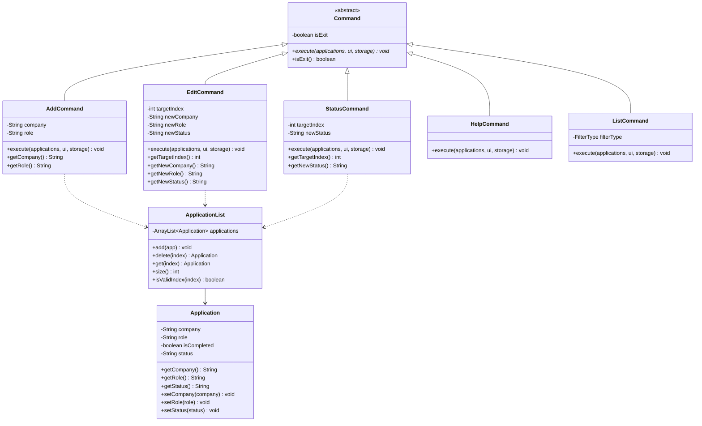
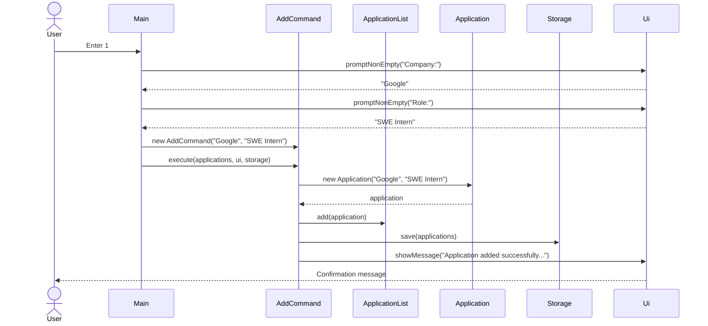
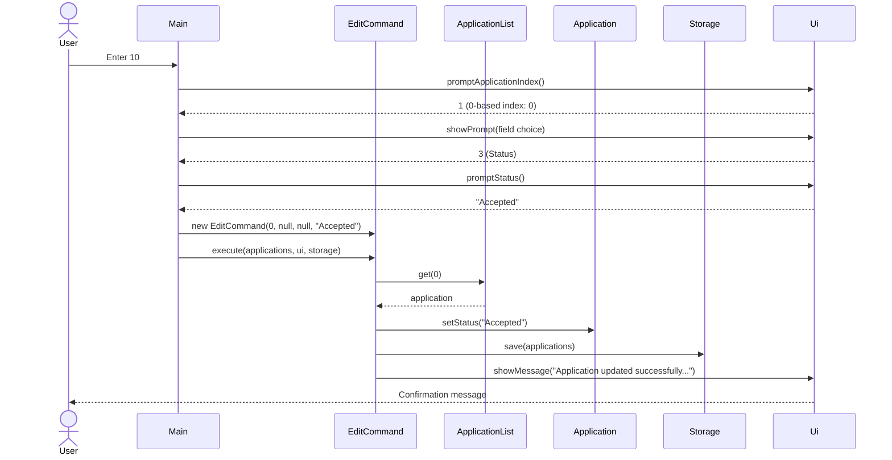
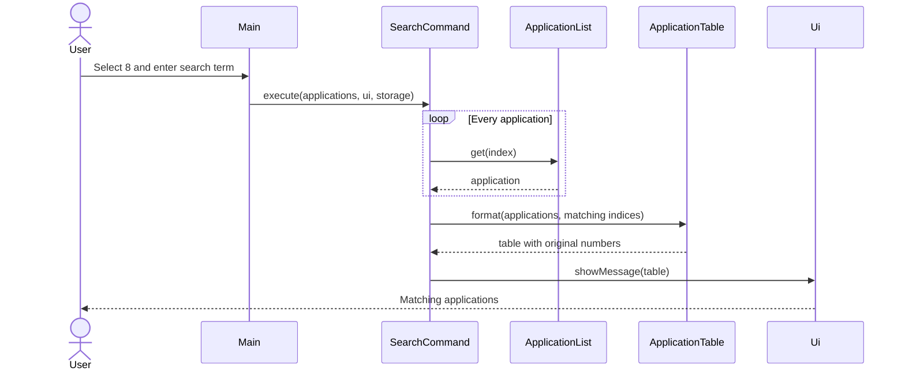

# Developer Guide

## Acknowledgements

{list here sources of all reused/adapted ideas, code, documentation, and third-party libraries -- include links to the original source as well}

## Design & implementation

### Architecture and Command pattern

JobSeek employs the Command pattern to decouple command dispatching (`Main`) from command execution and domain model manipulation. All actions inherit from the abstract `Command` class and implement the polymorphic `execute(ApplicationList, Ui, Storage)` method.



### Add application feature

The `AddCommand` allows job seekers to add a new internship or job record with a specified company and role.

- **Workflow**:
  1. `Main.handleMenuAdd()` queries the user for non-empty company and role strings using `promptNonEmpty()`. Blank or whitespace-only inputs are rejected with informative error messages and reprompted.
  2. Once valid strings are obtained, `Main` instantiates `AddCommand(company, role)`.
  3. `AddCommand.execute()` instantiates a new `Application`, which initializes with completion status `false` (`[ ]`) and recruitment status `"Pending"`.
  4. The application is added to `ApplicationList`. Internal assumptions (such as list size incrementing by 1 and target non-null) are verified via Java `assert`.
  5. The updated list is persisted to disk via `Storage.save(applications)`, and confirmation is rendered to the user via `Ui.showMessage()`.



### Edit application and recruitment status tracking

The edit feature allows users to modify existing applications without deleting and re-entering them. The status tracking feature categorizes applications into recruitment stages (`Pending`, `Accepted`, `Rejected`).

- **Design and Implementation**:
  - `EditCommand` accepts a zero-based target index and nullable field replacements: `newCompany`, `newRole`, and `newStatus`. A `null` value indicates that the corresponding field should remain unchanged.
  - `StatusCommand` provides direct, dedicated recruitment status modification for targeted application records.
  - In `Main.handleMenuEdit()`, the user chooses the target application index, followed by a field choice:
    - `1`: Company only
    - `2`: Role only
    - `3`: Status only
    - `4`: All three fields
  - Status input normalization in `Main.promptStatus()` accepts numeric shortcuts (`1` for Pending, `2` for Accepted, `3` for Rejected) as well as case-insensitive text strings.
  - **Defensive programming & Assertions**: Java `assert` statements verify preconditions (non-null arguments, in-bounds target indices) and postconditions (non-empty fields, updated status).



### Help feature

`HelpCommand` displays an extensive summary of all available numeric menu options (`[0]` to `[10]`) as well as standalone text commands (`list [completed|all]`, `view INDEX`). It implements the `Command` interface without mutating state or triggering disk storage writes.

### Search and alphabetical views

`Main` translates numeric menu input into a `Command`. Option `8` asks for a non-blank search term, then creates `SearchCommand`; option `9` creates `SortCommand`. Both commands operate on an `ApplicationList` but do not mutate it or call `Storage.save`.

The commands collect zero-based indices of matching applications. `SearchCommand` matches a case-insensitive substring against both company and role. `SortCommand` sorts a copy of the indices by company, then role, using a case-insensitive comparator; original index breaks ties. `ApplicationTable` formats either view with one-based numbers derived from the original indices. This keeps subsequent mark and delete commands unambiguous, even when the display order differs from storage order.



The alphabetical view follows the same formatting path after sorting the index copy. Keeping the list itself unchanged means there is no save operation and existing application numbers remain stable.


## Product scope
### Target user profile

{Describe the target user profile}

### Value proposition

{Describe the value proposition: what problem does it solve?}

## User Stories

| Version | As a ... | I want to ... | So that I can ... |
|---|---|---|---|
| v1.0 | student beginning to track applications | add a new job application | keep an opportunity in one central record |
| v1.0 | new user | see usage instructions | refer to them when I forget how to use the application |
| v2.0 | job seeker | find applications by company or role | locate an application without scanning the full list |
| v2.0 | job seeker | view applications alphabetically | compare applications by company and role more easily |
| v2.0 | student | edit the recorded details of an application | keep information accurate when details change or I make a mistake |
| v2.0 | student | record the current recruitment stage of an application | track my current progress for the application |

## Non-Functional Requirements

{Give non-functional requirements}

## Glossary

* *glossary item* - Definition

## Instructions for manual testing

{Give instructions on how to do a manual product testing e.g., how to load sample data to be used for testing}

### Adding an application

1. Launch JobSeek with an empty list.
2. Select `1`. When prompted for `Company:`, press Enter without typing. Confirm error `Error: Company cannot be empty.` appears and the prompt repeats.
3. Enter `Google`. When prompted for `Role:`, enter `SWE Intern`. Confirm confirmation message:
   ```text
   Application added successfully.
   Company: Google
   Role: SWE Intern
   ```
4. Choose `2` to list applications. Confirm the new record appears in the active applications table with `No.` 1, `Status` `[ ]`, `Company` `Google`, and `Role` `SWE Intern`.

### Viewing help instructions

1. Enter `7` from the main menu.
2. Verify that all menu options `[0]` through `[10]` and shortcuts `list [completed|all]` and `view INDEX` are displayed.

### Editing application fields

1. Start JobSeek with an empty application list and choose `10`. Confirm `Error: Your application list is currently empty.` appears.
2. Add an application using `1` with company `Googl` and role `SWE Intern`.
3. Choose `10` and enter application index `1`.
4. Choose `1` (Company). Enter `Google`. Confirm confirmation output displays `Company: Google`, `Role: SWE Intern`, and `Status: Pending`.
5. Choose `10` and enter index `1`. Choose `2` (Role). Enter `Backend Intern`. Confirm role is updated to `Backend Intern` while company remains `Google` and status remains `Pending`.
6. Choose `10` and test invalid inputs: enter non-numeric index `abc` or out-of-bounds `99`. Confirm clear error messages are displayed.

### Managing recruitment status

1. Add an application with company `Shopee` and role `Backend Intern`.
2. Enter `view 1`. Verify `Status:    Pending` is displayed by default.
3. Choose `10`, index `1`, and field `3` (Status). Enter `2` (shortcut for Accepted).
4. Enter `view 1`. Verify `Status:    Accepted` is now displayed.
5. Choose `10`, index `1`, field `3`. Enter `Rejected` (case-insensitive text). Enter `view 1` and verify `Status:    Rejected`.
6. Choose `10`, index `1`, field `4` (All). Enter company `Sea`, role `Data Analyst`, and status `1` (Pending). Verify all fields updated correctly.

### Search and sort

1. Start JobSeek with an empty application list and add `Zulu / Engineer`, `Acme / Designer`, and `Acme / Analyst` using option `1`.
2. Choose `8` and search for `ENG`. Confirm that only `Zulu / Engineer` appears with number `1`. Search for `acm` and confirm that both Acme applications appear with their original numbers `2` and `3`.
3. Search for a term that does not occur in any company or role. Confirm that a no-matches message appears. Enter a blank term and confirm that the program asks again.
4. Choose `9`. Confirm the view shows `Acme / Analyst` (`3`), `Acme / Designer` (`2`), then `Zulu / Engineer` (`1`).
5. Type `list all`. Confirm the original order is still `Zulu`, `Acme / Designer`, `Acme / Analyst`.
