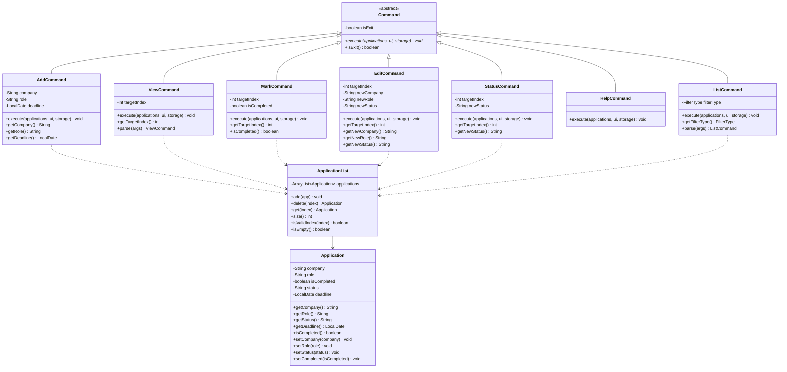
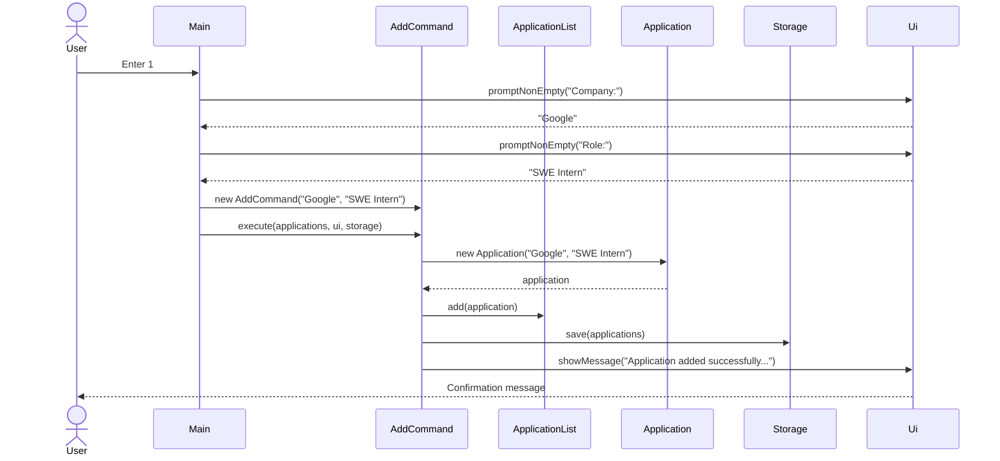
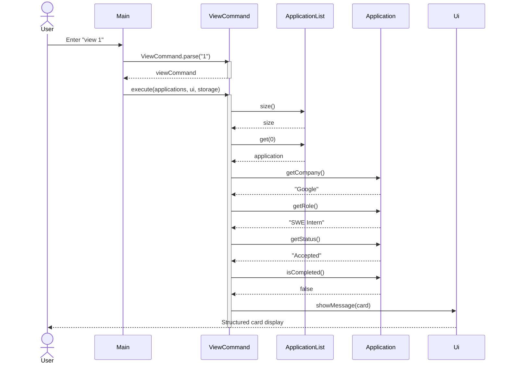
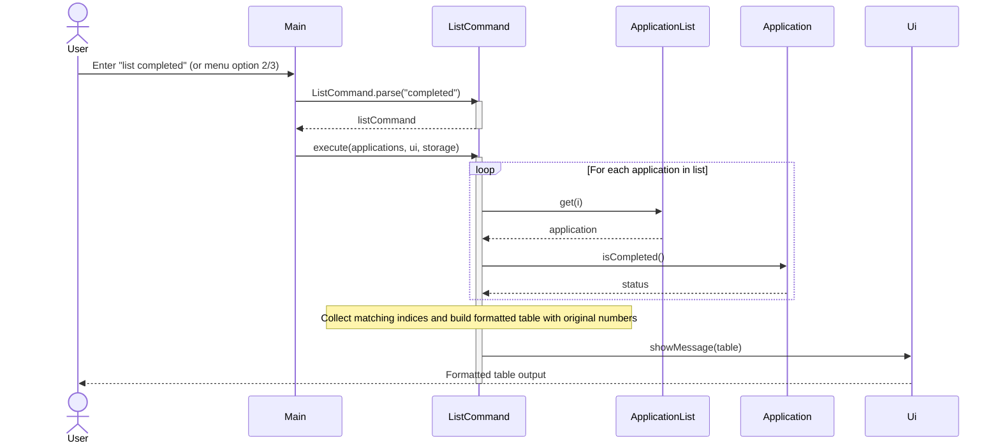
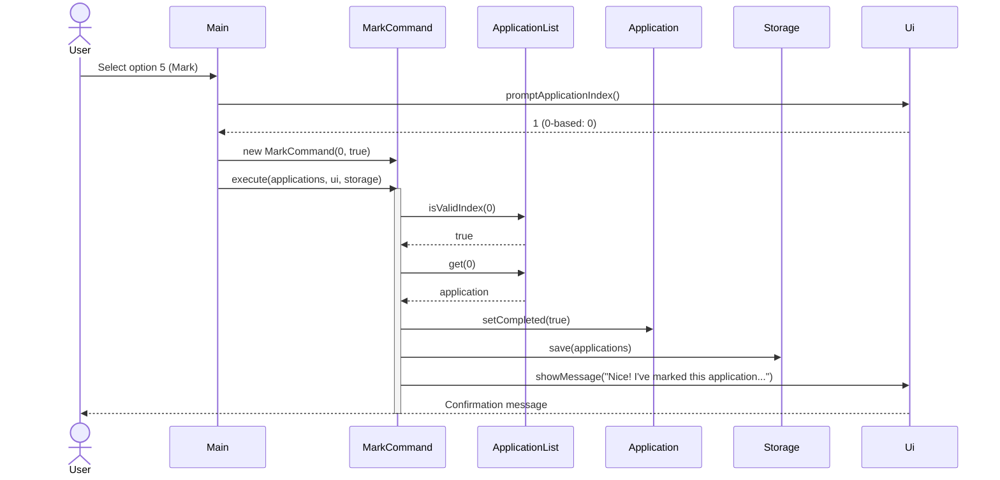
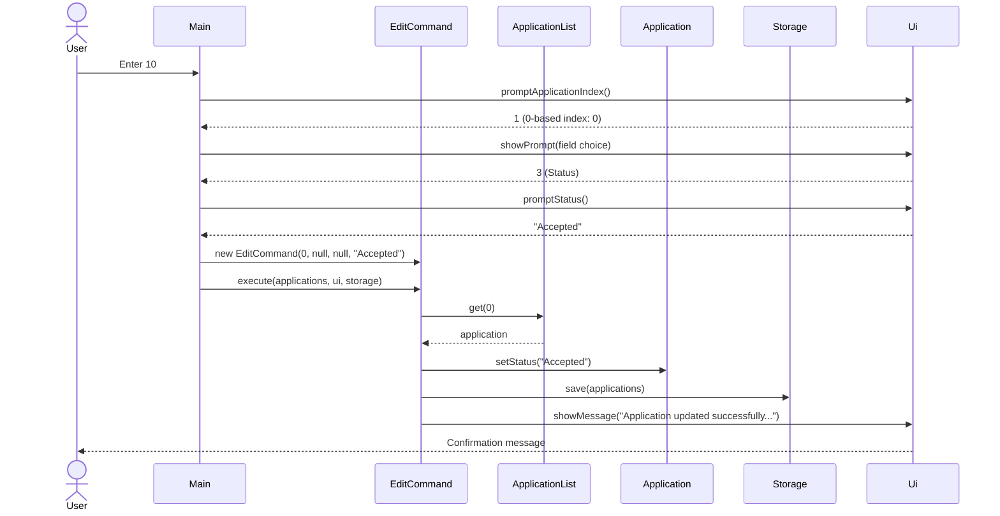
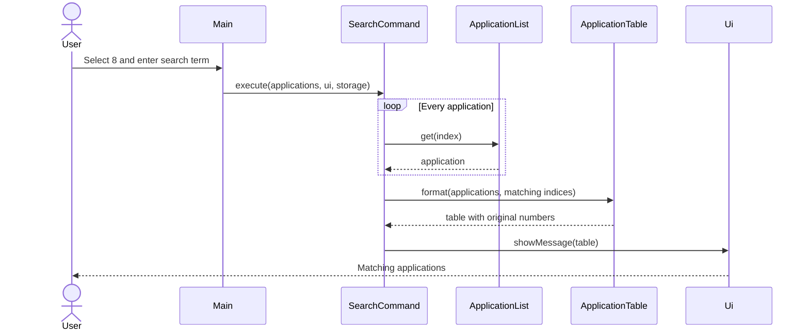
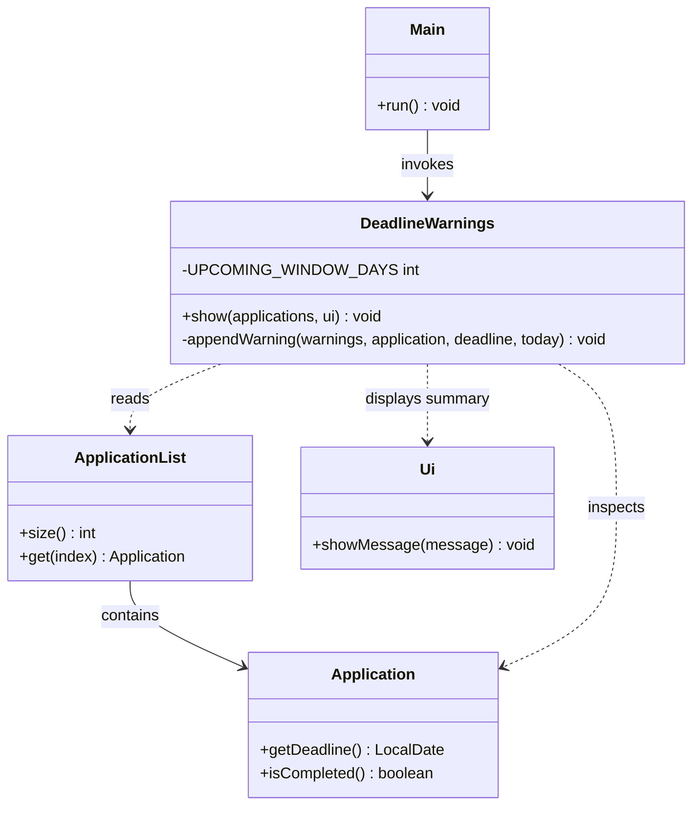
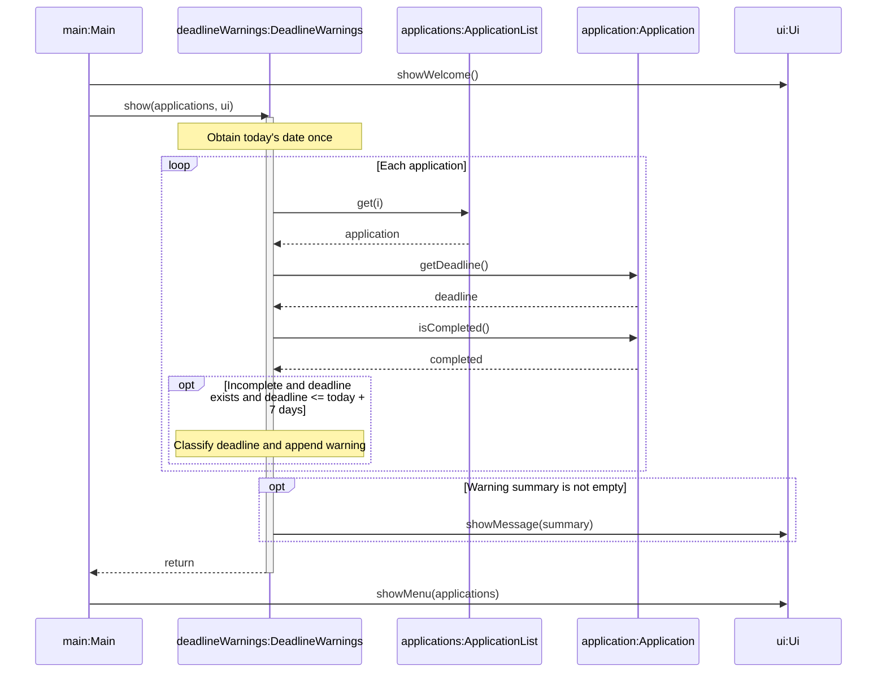

# Developer Guide

## Acknowledgements

* **[AddressBook-Level3 (AB3)](https://github.com/se-edu/addressbook-level3)**: Original codebase structure and documentation layout adapted for our project.
* **Libraries Used**:
  * [Jackson](https://github.com/FasterXML/jackson) for JSON serialization and parsing.
  * [JUnit 5](https://junit.org/junit5/) for unit testing and automated test execution.
* **Documentation & Tools**:
  * [Mermaid](https://mermaid.js.org/) for rendering UML class and sequence diagrams.
  * [JavaFX](https://openjfx.io/) for graphical user interface components.

## Design & implementation

### Architecture and Command pattern

JobSeek employs the Command pattern to decouple command dispatching (`Main`) from command execution and domain model manipulation. All actions inherit from the abstract `Command` class and implement the polymorphic `execute(ApplicationList, Ui, Storage)` method.



### Add application feature

The `AddCommand` allows job seekers to add a new internship or job record with a specified company and role.

- **Workflow**:
  1. `Main.handleMenuAdd()` queries the user for non-empty company and role strings using `promptNonEmpty()`. Blank or whitespace-only inputs are rejected with informative error messages and reprompted.
  2. Once valid strings are obtained, `Main` instantiates `AddCommand(company, role)`.
  3. `AddCommand.execute()` instantiates a new `Application`, which initializes with completion status `false` (`[ ]`) and recruitment status `"Pending"`.
  4. The application is added to `ApplicationList`. Internal assumptions (such as list size incrementing by 1 and target non-null) are verified via Java `assert`.
  5. The updated list is persisted to disk via `Storage.save(applications)`, and confirmation is rendered to the user via `Ui.showMessage()`.



### View application feature

#### Overview
The `ViewCommand` displays all recorded information for an individual application as a structured, visual card. It is executed via the `view <application_number>` standalone command.

#### Design and implementation
- **Parsing**: `ViewCommand.parse(String args)` parses user input following the `view` command prefix. It validates that the argument is a non-empty, positive integer (`1`-based). If the argument is invalid or non-numeric, it throws a `JobSeekException` with helpful usage instructions (`Usage: view INDEX`).
- **Execution**:
  1. `ViewCommand.execute(ApplicationList, Ui, Storage)` validates that the zero-based target index satisfies `0 <= targetIndex < applications.size()`.
  2. If the index is out of bounds, it throws a `JobSeekException` reporting the invalid index and the current list size (e.g., `Application index 5 does not exist. (Total applications: 3)`).
  3. Upon successful bounds validation, it retrieves the target `Application` via `applications.get(targetIndex)`.
  4. It constructs a visual card bordered with dividers, displaying the application's company, role, recruitment status (`Pending`, `Accepted`, `Rejected`), and completion status (`Yes` or `No`).
  5. The card is rendered via `Ui.showMessage()`.
  6. Because `ViewCommand` is a read-only operation, it does not modify the application list or trigger disk persistence.



#### Design considerations
- **Card view vs tabular view**:
  - *Current choice*: A structured card view focuses on one record at a time, providing space to cleanly display all recorded attributes (including recruitment status and completion status) without line truncation or horizontal overflow.
  - *Alternative*: Adding more columns to the standard list table. This was rejected because widening the table reduces readability on smaller terminal windows and clutters the overview.
- **Read-only decoupling**:
  - `ViewCommand` adheres to the Command pattern without calling `Storage.save()`, ensuring zero disk I/O overhead.

### Filtered application listing feature

#### Overview
The `ListCommand` presents applications in an aligned ASCII table. It supports completion-status filtering so users can focus on active applications, completed applications, or inspect all tracked opportunities.

#### Design and implementation
- **Filter criteria**: Controlled by the `FilterType` enum:
  - `ACTIVE`: Displays only uncompleted applications (`isCompleted() == false`).
  - `COMPLETED`: Displays only completed applications (`isCompleted() == true`).
  - `ALL`: Displays all applications regardless of completion state.
- **Triggering mechanisms**:
  - Standalone text commands: `list` (defaults to `ACTIVE`), `list completed`, `list all`. Parsed by `ListCommand.parse(String args)`. Unrecognized filters throw a `JobSeekException` with usage instructions.
  - Numeric menu options: Menu option `2` (`List applications`) and menu option `3` (`List uncompleted applications`) both instantiate `ListCommand(FilterType.ACTIVE)`.
- **Workflow**:
  1. `ListCommand.execute()` checks if `applications.isEmpty()`. If the list is empty, it outputs `"No applications found."`.
  2. Iterates over all applications and collects the zero-based indices of matching records into an `ArrayList<Integer> matchingIndices` using `matchesFilter(app)`.
  3. If no records match the chosen filter, context-sensitive feedback is displayed:
     - `COMPLETED`: `"No completed applications found."`
     - `ACTIVE`: `"No active applications found."`
     - `ALL`: `"No applications found."`
  4. Dynamically calculates column widths for `No.`, `Status`, `Company`, `Role`, and `Deadline` based on the longest values among matching entries, guaranteeing clean tabular alignment.
  5. Renders each matching row, preserving the application's original 1-based index (`index + 1`).
  6. Displays the formatted table via `Ui.showMessage()`.



#### Design considerations
- **Preserving original 1-based indices**:
  - *Current choice*: The `No.` column displays the application's original index from `ApplicationList` rather than re-indexing from 1 in the filtered view. This guarantees that numbers remain consistent across `list`, `list completed`, `view`, `mark`, `edit`, and `delete` commands.
  - *Alternative*: Re-numbering matching rows sequentially (1, 2, ...). This was rejected because it introduces confusion when users attempt to execute `view` or `mark` on an application whose display number differs from its list position.
- **Default to active applications**:
  - Job seekers primarily need to review and act upon active, ongoing applications. Concluded applications are hidden by default to keep the interface concise and relevant.

### Mark and unmark application completion feature

#### Overview
The `MarkCommand` allows users to toggle an application's lifecycle between active/incomplete (`[ ]`) and completed (`[X]`). Completed applications are typically archived from the default active list.

#### Design and implementation
- **Menu triggers**:
  - Menu option `5`: Calls `handleMenuMark(true)` to mark an application as completed.
  - Menu option `6`: Calls `handleMenuMark(false)` to unmark an application.
- **Workflow**:
  1. `Main.promptApplicationIndex()` prompts the user for the 1-based application index and converts it to a zero-based integer.
  2. `Main` instantiates `MarkCommand(targetIndex, isCompleted)`.
  3. `MarkCommand.execute(applications, ui, storage)` checks whether `applications.isEmpty()`. If empty, it displays an error message via `Ui.showError()`.
  4. Validates that `targetIndex` is valid using `applications.isValidIndex(targetIndex)`. If invalid, displays a bounds error (e.g., `Invalid application index: 4. Please enter a number between 1 and 2.`).
  5. Retrieves the application and updates its completion state using `application.setCompleted(isCompleted)`.
  6. Displays a confirmation message showing the updated application representation:
     - Marked: `"Nice! I've marked this application as completed:\n  " + application`
     - Unmarked: `"OK, I've marked this application as not completed yet:\n  " + application`
  7. Persists the modification to disk immediately via `Storage.save(applications)`.



#### Design considerations
- **Single unified command vs separate commands**:
  - *Current choice*: A unified `MarkCommand` parameterized with boolean `isCompleted`. The workflow for validation, index checking, list mutation, and disk persistence is identical for both actions; unifying them eliminates code duplication.
  - *Alternative*: Separate `MarkCommand` and `UnmarkCommand` classes. This was rejected to avoid redundant boilerplate and maintenance overhead.
- **Immediate disk persistence**:
  - Changes to completion status immediately invoke `Storage.save(applications)` to guarantee that completion progress is preserved across application crashes or restarts.

### Edit application and recruitment status tracking

The edit feature allows users to modify existing applications without deleting and re-entering them. The status tracking feature categorizes applications into recruitment stages (`Pending`, `Accepted`, `Rejected`).

- **Design and Implementation**:
  - `EditCommand` accepts a zero-based target index and nullable field replacements: `newCompany`, `newRole`, and `newStatus`. A `null` value indicates that the corresponding field should remain unchanged.
  - `StatusCommand` provides direct, dedicated recruitment status modification for targeted application records.
  - In `Main.handleMenuEdit()`, the user chooses the target application index, followed by a field choice:
    - `1`: Company only
    - `2`: Role only
    - `3`: Status only
    - `4`: All three fields
  - Status input normalization in `Main.promptStatus()` accepts numeric shortcuts (`1` for Pending, `2` for Accepted, `3` for Rejected) as well as case-insensitive text strings.
  - **Defensive programming & Assertions**: Java `assert` statements verify preconditions (non-null arguments, in-bounds target indices) and postconditions (non-empty fields, updated status).



### Help feature

`HelpCommand` displays an extensive summary of all available numeric menu options (`[0]` to `[10]`) as well as standalone text commands (`list [completed|all]`, `view INDEX`). It implements the `Command` interface without mutating state or triggering disk storage writes.

### Search and alphabetical views

`Main` translates numeric menu input into a `Command`. Option `8` asks for a non-blank search term, then creates `SearchCommand`; option `9` creates `SortCommand`. Both commands operate on an `ApplicationList` but do not mutate it or call `Storage.save`.

The commands collect zero-based indices of matching applications. `SearchCommand` matches a case-insensitive substring against both company and role. `SortCommand` sorts a copy of the indices by company, then role, using a case-insensitive comparator; original index breaks ties. `ApplicationTable` formats either view with one-based numbers derived from the original indices. This keeps subsequent mark and delete commands unambiguous, even when the display order differs from storage order.



The alphabetical view follows the same formatting path after sorting the index copy. Keeping the list itself unchanged means there is no save operation and existing application numbers remain stable.

### Startup deadline warnings

#### Overview

The startup deadline warnings feature helps users identify applications that require attention when they launch JobSeek. It displays a summary of overdue deadlines, deadlines due today, and deadlines within the next seven days.

Warnings apply only to applications that have not been marked as completed. Applications without a recorded deadline are excluded. This allows users to track applications even when their deadlines are unknown.

For example, if the current date is `2026-10-28`, an incomplete application with a deadline of `2026-10-27` is classified as `OVERDUE`, while one with a deadline of `2026-10-30` is classified as `UPCOMING`.

#### Design and implementation

The feature involves the following classes:

| Class | Responsibility |
|---|---|
| `Main` | Coordinates startup and invokes the deadline check before displaying the menu. |
| `DeadlineWarnings` | Selects applications requiring attention and builds the warning summary. |
| `ApplicationList` | Provides access to the stored application records. |
| `Application` | Stores the optional deadline and completion flag for each application. |
| `Ui` | Displays the warning summary to the user. |

The following class diagram shows the relationships relevant to deadline checking. Unrelated fields and methods are omitted.



Each application's deadline is represented using `LocalDate`. A `null` deadline indicates that no deadline has been recorded. `LocalDate` supports comparisons between calendar dates without requiring a time of day.

During normal startup, `Main` loads saved applications through `Storage` before `run()` begins. Within `run()`, it displays the welcome message, calls `DeadlineWarnings.show(applications, ui)`, and then displays the menu.

`DeadlineWarnings.show()` obtains the current date once using `LocalDate.now()`. It then iterates through the applications and excludes any record that:

- Has been marked as completed.
- Has no recorded deadline.
- Has a deadline later than seven days after the current date.

The remaining applications are classified using the following rules:

| Deadline relative to today | Classification |
|---|---|
| Earlier than today | `OVERDUE` |
| Equal to today | `DUE TODAY` |
| After today, up to and including seven days away | `UPCOMING` |

The seven-day boundary is inclusive. For example, when today is `2026-10-28`, a deadline of `2026-11-04` is included, while `2026-11-05` is excluded. There is no lower date limit for overdue applications.

The private `appendWarning()` method adds each warning to a `StringBuilder`. Each entry contains its classification, company, role and deadline. After checking all applications, `show()` displays the accumulated summary through a single call to `Ui.showMessage()`. If no applications qualify, it displays no warning message.

#### Sequence of interactions

The following sequence diagram illustrates the deadline check after saved applications have been loaded. Warning classification and formatting are summarised in a note to keep the diagram focused on interactions between objects.



#### Design considerations

**Separate warning logic from startup coordination.**  
`Main` controls when the check occurs, while `DeadlineWarnings` handles selection and classification. This keeps deadline rules in one class and allows them to be changed without expanding the startup workflow. An alternative would be to place the entire check inside `Main.run()`, but that would give `Main` additional responsibility for deadline processing.

**Derive warnings from application data.**  
Warning classifications are calculated from the deadline and current date whenever the application starts. They are not stored separately. This avoids persisting a classification such as `UPCOMING` that could become outdated as time passes.

**Display one consolidated summary.**  
Accumulating warnings before displaying them groups all relevant deadlines together. It also keeps the output operation separate from the iteration over application records.

#### Current limitations and possible extensions

The check runs once at startup. Warnings do not automatically refresh after an application is added or when the date changes while JobSeek remains open. A possible extension is to provide a command that invokes the same check on demand.

The upcoming window is currently fixed at seven days through `UPCOMING_WINDOW_DAYS`. It could later become configurable.

The implementation uses the system's current date directly. A future improvement could inject a `Clock` to make date-boundary tests independent of the day on which they run.

### Local storage

#### Overview

The local storage feature preserves application records between JobSeek sessions. Applications are saved to `data/applications.txt` and loaded when the program starts.

The `Storage` class handles file access and conversion between application objects and their text representation. This keeps file-handling details separate from command execution and user interaction.

#### Design and implementation

The feature involves the following classes:

| Class | Responsibility |
|---|---|
| `Storage` | Reads and writes application records in the local data file. |
| `ApplicationList` | Holds the application records in memory. |
| `Application` | Represents an individual application and its stored fields. |
| `Main` | Loads saved records during startup and reports loading errors. |

`Storage` uses `data/applications.txt` by default. Its constructor also accepts a custom file path, allowing tests to use temporary files without modifying the user's saved data.

#### File format

The file uses UTF-8 encoding and contains two header lines followed by application records. Each record contains four tab-separated fields:

| Field | Representation |
|---|---|
| Company | Escaped text |
| Role | Escaped text |
| Completion flag | `true` or `false` |
| Deadline | ISO date such as `2026-11-03`, or an empty field |

An empty deadline field represents an application without a recorded deadline.

Backslashes, tabs, newlines and carriage returns within text fields are escaped before saving. During loading, `splitFields()` decodes these escape sequences. This prevents characters inside company or role names from being mistaken for field or record separators.

**Current limitation:** Recruitment status (`Pending`, `Accepted` or `Rejected`) is not included in the stored format. Therefore, changes to this status are not preserved by the current storage implementation.

#### Saving applications

Commands that modify application data call `Storage.save(applications)` to persist the updated list.

The save operation performs the following steps:

1. Converts the configured file path into a `Path`.
2. Creates missing parent directories, if required.
3. Adds the title and column headers.
4. Converts each application into a tab-separated record.
5. Writes the complete contents using UTF-8 encoding.

The operation rewrites the file using the current list. Consequently, applications removed from the list are also removed from the saved data.

#### Loading applications

During normal startup, `Main` calls `Storage.load()` before entering the main interaction loop.

If the file does not exist, `load()` returns an empty `ApplicationList`. Otherwise, it reads the file and processes each line. Blank lines, comment lines beginning with `#`, and recognised header lines are ignored.

For each application record, `Storage` checks that there are exactly four fields and that the completion flag is either `true` or `false`. A non-empty deadline is parsed using `LocalDate.parse()`. Valid records are reconstructed as `Application` objects and added to the list.

The following sequence diagram shows successful loading of an existing file. File-reading details are summarised in a note.

```mermaid
sequenceDiagram
    participant main as Main
    participant storage as storage:Storage
    participant list as applications:ApplicationList
    participant app as application:Application

    main->>storage: load()
    activate storage
    Note over storage: Read UTF-8 file if it exists
    create participant list
    storage->>list: new ApplicationList()

    loop Each application record
        Note over storage: Decode fields and validate record
        create participant app
        storage->>app: new Application(company, role, completed, deadline)
        storage->>list: add(application)
    end

    storage-->>main: applications
    deactivate storage
```

#### Error handling

Invalid field counts, completion flags, deadlines or escape sequences cause loading to fail with an `IOException`. Field-count, completion-flag and deadline errors identify the affected line.

`Main.loadApplications()` catches loading exceptions, displays an error through `Ui.showError()`, and returns an empty list. A failed load therefore does not return a partially loaded application list.

Saving errors propagate to the caller. During command execution, `Main` catches these errors and displays an error message.

#### Design considerations

**Human-readable text format.**  
The tab-separated format is simple to inspect and uses Java's standard file APIs. An alternative would be JSON, which could represent additional fields more explicitly but would require a different serialisation approach.

**Save the complete list.**  
Rewriting the complete list keeps persistence straightforward because additions, updates and deletions use the same save operation. The trade-off is that each save processes every application.

**Separate persistence from application logic.**  
Commands request a save without implementing file encoding or parsing themselves. Changes to the storage format can therefore be concentrated in `Storage`.

#### Possible improvements

A future version could persist recruitment status and support older file formats. Saving could also use a temporary file followed by an atomic replacement to reduce the risk of an interrupted write damaging the existing data file.

Loading currently falls back to an empty list after an error. A future recovery mechanism could protect the original file from being overwritten by subsequent saves until the user resolves the loading problem.

## Product scope
### Target user profile

{Describe the target user profile}

### Value proposition

{Describe the value proposition: what problem does it solve?}

## User Stories

| Version | As a ... | I want to ... | So that I can ... |
|---|---|---|---|
| v1.0 | student beginning to track applications | add a new job application | keep an opportunity in one central record |
| v1.0 | new user | see usage instructions | refer to them when I forget how to use the application |
| v1.0 | job seeker | view detailed information of a specific application | inspect all fields including recruitment status and deadlines in a structured card |
| v1.0 | job seeker | mark an application as completed | track which applications have concluded their recruitment cycle |
| v1.0 | job seeker | unmark a completed application | reopen an application if the recruitment process resumes or if marked by mistake |
| v2.0 | job seeker | find applications by company or role | locate an application without scanning the full list |
| v2.0 | job seeker | view applications alphabetically | compare applications by company and role more easily |
| v2.0 | job seeker | filter applications by active or completed status | focus on pending applications without distraction from completed ones |
| v2.0 | student | edit the recorded details of an application | keep information accurate when details change or I make a mistake |
| v2.0 | student | record the current recruitment stage of an application | track my current progress for the application |

## Non-Functional Requirements

{Give non-functional requirements}

## Glossary

* *glossary item* - Definition

## Instructions for manual testing

{Give instructions on how to do a manual product testing e.g., how to load sample data to be used for testing}

### Adding an application

1. Launch JobSeek with an empty list.
2. Select `1`. When prompted for `Company:`, press Enter without typing. Confirm error `Error: Company cannot be empty.` appears and the prompt repeats.
3. Enter `Google`. When prompted for `Role:`, enter `SWE Intern`. Confirm confirmation message:
   ```text
   Application added successfully.
   Company: Google
   Role: SWE Intern
   ```
4. Choose `2` to list applications. Confirm the new record appears in the active applications table with `No.` 1, `Status` `[ ]`, `Company` `Google`, and `Role` `SWE Intern`.

### Viewing help instructions

1. Enter `7` from the main menu.
2. Verify that all menu options `[0]` through `[10]` and shortcuts `list [completed|all]` and `view INDEX` are displayed.

### Viewing application details

1. Start JobSeek and add an application with company `Google` and role `SWE Intern`.
2. Enter `view 1`. Confirm that a structured details card appears:
   ```text
   ==================================================
   Application Details [Index: 1]
   --------------------------------------------------
   Company:   Google
   Role:      SWE Intern
   Status:    Pending
   Completed: No
   ==================================================
   ```
3. Test invalid and boundary inputs:
   - Enter `view` (no index). Confirm error: `Error: Please provide a valid positive application index. Usage: view INDEX`.
   - Enter `view 0` or `view -1`. Confirm error: `Error: Please provide a valid positive application index. Usage: view INDEX`.
   - Enter `view abc`. Confirm error: `Error: Please provide a valid positive application index. Usage: view INDEX`.
   - Enter `view 99` (out of bounds). Confirm error: `Error: Application index 99 does not exist. (Total applications: 1)`.

### Listing and filtering applications

1. Start JobSeek with an empty list. Choose `2` or type `list`. Confirm `No applications found.` appears.
2. Add three applications:
   - Application 1: `Google / SWE Intern`
   - Application 2: `Shopee / Backend Intern`
   - Application 3: `GovTech / Fullstack Developer`
3. Mark Application 2 as completed using option `5`.
4. Test active filter (default):
   - Choose `2` (or option `3`, or type `list`).
   - Confirm only Application 1 and Application 3 appear in the table with their original list numbers `1` and `3`. Application 2 is not listed.
5. Test completed filter:
   - Type `list completed`.
   - Confirm only Application 2 appears in the table with `No.` `2` and `Status` `[X]`.
6. Test all filter:
   - Type `list all`.
   - Confirm all three applications (1, 2, 3) are displayed in the table.
7. Test unrecognized filter:
   - Type `list pending`.
   - Confirm error appears: `Error: Invalid list filter: 'pending'. Usage: list [completed|all]`.

### Marking and unmarking applications

1. Have at least one uncompleted application (e.g. Application 1 `[ ] Google`).
2. Choose option `5` (Mark completed). Enter `1`.
   - Confirm confirmation message:
     ```text
     Nice! I've marked this application as completed:
       [X] Google | Role: SWE Intern
     ```
3. Type `list`. Confirm Application 1 is no longer in the active list.
4. Type `list completed`. Confirm Application 1 appears with status `[X]`.
5. Choose option `6` (Unmark). Enter `1`.
   - Confirm confirmation message:
     ```text
     OK, I've marked this application as not completed yet:
       [ ] Google | Role: SWE Intern
     ```
6. Type `list`. Confirm Application 1 reappears in the active list with `[ ]`.
7. Test invalid inputs for marking and unmarking:
   - Enter non-numeric input `xyz` at the index prompt. Confirm error `Error: Invalid application index. Please enter a valid number.` appears.
   - Enter out-of-bounds index `99`. Confirm error `Error: Invalid application index: 99. Please enter a number between 1 and 3.` appears.

### Editing application fields

1. Start JobSeek with an empty application list and choose `10`. Confirm `Error: Your application list is currently empty.` appears.
2. Add an application using `1` with company `Googl` and role `SWE Intern`.
3. Choose `10` and enter application index `1`.
4. Choose `1` (Company). Enter `Google`. Confirm confirmation output displays `Company: Google`, `Role: SWE Intern`, and `Status: Pending`.
5. Choose `10` and enter index `1`. Choose `2` (Role). Enter `Backend Intern`. Confirm role is updated to `Backend Intern` while company remains `Google` and status remains `Pending`.
6. Choose `10` and test invalid inputs: enter non-numeric index `abc` or out-of-bounds `99`. Confirm clear error messages are displayed.

### Managing recruitment status

1. Add an application with company `Shopee` and role `Backend Intern`.
2. Enter `view 1`. Verify `Status:    Pending` is displayed by default.
3. Choose `10`, index `1`, and field `3` (Status). Enter `2` (shortcut for Accepted).
4. Enter `view 1`. Verify `Status:    Accepted` is now displayed.
5. Choose `10`, index `1`, field `3`. Enter `Rejected` (case-insensitive text). Enter `view 1` and verify `Status:    Rejected`.
6. Choose `10`, index `1`, field `4` (All). Enter company `Sea`, role `Data Analyst`, and status `1` (Pending). Verify all fields updated correctly.

### Search and sort

1. Start JobSeek with an empty application list and add `Zulu / Engineer`, `Acme / Designer`, and `Acme / Analyst` using option `1`.
2. Choose `8` and search for `ENG`. Confirm that only `Zulu / Engineer` appears with number `1`. Search for `acm` and confirm that both Acme applications appear with their original numbers `2` and `3`.
3. Search for a term that does not occur in any company or role. Confirm that a no-matches message appears. Enter a blank term and confirm that the program asks again.
4. Choose `9`. Confirm the view shows `Acme / Analyst` (`3`), `Acme / Designer` (`2`), then `Zulu / Engineer` (`1`).
5. Type `list all`. Confirm the original order is still `Zulu`, `Acme / Designer`, `Acme / Analyst`.
