# Developer Guide

## Acknowledgements

* **[AddressBook-Level3 (AB3)](https://github.com/se-edu/addressbook-level3)**: Original codebase structure and documentation layout adapted for our project.
* **Libraries Used**:
  * [JUnit 5](https://junit.org/junit5/) for unit testing and automated test execution.
* **Documentation & Tools**:
  * [Mermaid](https://mermaid.js.org/) for rendering UML class and sequence diagrams.
  * [Gradle](https://gradle.org/) and [Checkstyle](https://checkstyle.sourceforge.io/) for building, testing and enforcing code style.

## Design & implementation

### Architecture Overview

JobSeek is a command-line desktop application for managing internship and job applications. The application architecture is organized into five primary components:

* **`Main`**: Acts as the central coordinator and entry point. It initializes core dependencies, checks deadline alerts, parses user input into commands, and manages the execution loop.
* **`UI`**: Consists of `Ui` and `ApplicationTable`. It reads console inputs, renders formatted tables, application cards, deadline warning banners, and error notifications.
* **`Logic / Command`**: Built upon the Command pattern. Encapsulates all executable actions (`AddCommand`, `DeleteCommand`, `EditCommand`, `ListCommand`, etc.) inheriting from the common abstract `Command` base class.
* **`Model`**: Comprises `ApplicationList`, `Application`, and `DeadlineWarnings`. Represents in-memory domain entities, their validation rules, and lifecycle states (`Pending`, `Accepted`, `Rejected`, and completion flags).
* **`Storage`**: Encapsulated by `Storage`. Handles file encoding/decoding and persistent reading/writing to `data/applications.txt`.

#### Architecture Diagram

The high-level interaction between the user, UI, logic controller, domain model, and storage subsystem is shown below:

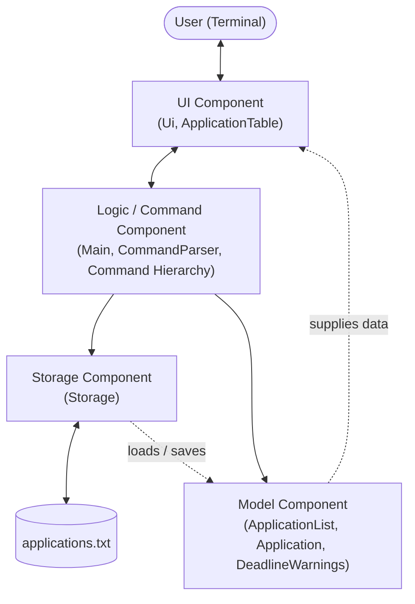

#### Application Lifecycle Activity Diagram

The control flow from startup, file loading, deadline inspection, command execution, and termination is illustrated in the activity diagram below:

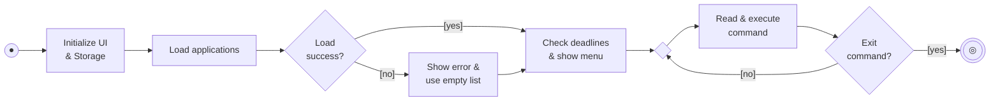

#### Runtime Object Structure (Object Diagram)

The following object diagram illustrates a concrete runtime snapshot of JobSeek after two applications have been loaded and tracked in memory:

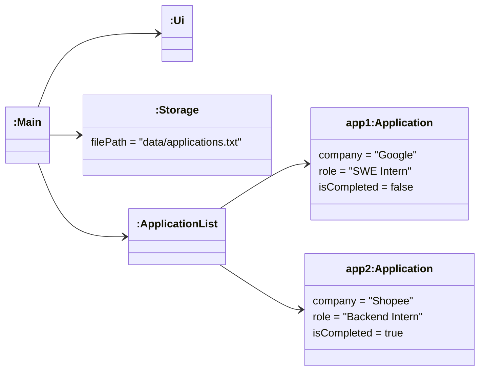

### Architecture and Command pattern

JobSeek is a single-user command-line application. `Main` reads one line at a time from `Ui`, turns it into a `Command`, and runs it. Every action inherits from the abstract `Command` class and implements the polymorphic `execute(ApplicationList, Ui, Storage)` method. This is the Command pattern: `Main` (which dispatches) does not need to know what each command does.

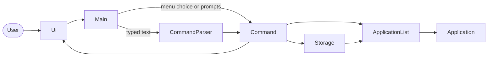

| Component | Package | Responsibility |
|---|---|---|
| `Main` | `jobseek` | Startup, the read-parse-execute loop, the numbered menu prompts, and the undo history. |
| `CommandParser` | `jobseek.parser` | Turns one-line typed commands such as `add c/Google r/SWE` into `Command` objects. |
| `Command` and subclasses | `jobseek.command` | One class per user action. |
| `ApplicationList`, `Application`, `RecruitmentStage`, `ApplicationFilters` | `jobseek.model` | The in-memory data and the rules about it. |
| `Storage` | `jobseek.storage` | Saves and loads `data/applications.txt`. |
| `Ui` | `jobseek.ui` | All console input and output. |
| `DeadlineWarnings` | `jobseek` | Builds the warning summary shown at startup. |

**Command hierarchy.** Commands that change the list extend `UndoableCommand`, which adds `undo` (see [Delete confirmation and undo](#delete-confirmation-and-undo)). Commands that only display information extend `Command` directly.

#### Overall Architecture Class Diagram

The class diagram below illustrates the structural relationships, associations, dependencies, and explicit UML multiplicities across the core components (`Main`, `Ui`, `Storage`, domain model, and `Command`):

```mermaid
---
config:
  themeVariables:
    fontSize: "16px"
---
classDiagram
    direction TB
    class Main {
        - ui: Ui
        - storage: Storage
        - applications: ApplicationList
        + run(): void
        + parseCommand(option: String): Command
    }
    class Ui {
        + showWelcome(): void
        + showMenu(applications: ApplicationList): void
        + showMessage(message: String): void
        + showError(errorMessage: String): void
        + showPrompt(prompt: String): void
        + readCommand(): String
        + showGoodbye(): void
    }
    class Storage {
        - filePath: String
        + save(applications: ApplicationList): void
        + load(): ApplicationList
    }
    class DeadlineWarnings {
        + show(applications: ApplicationList, ui: Ui)$: void
    }
    class JobSeekException {
        + JobSeekException(message: String)
    }
    class Command {
        <<abstract>>
        - isExit: boolean
        + execute(applications: ApplicationList, ui: Ui, storage: Storage)*: void
        + isExit(): boolean
    }
    class UndoableCommand {
        <<abstract>>
        - hasChanged: boolean
        # markChanged(): void
        + hasChanged(): boolean
        + undo(applications: ApplicationList)*: String
    }
    }
    Command <|-- UndoableCommand
    UndoableCommand <|-- AddCommand
    UndoableCommand <|-- DeleteCommand
    UndoableCommand <|-- EditCommand
    UndoableCommand <|-- StatusCommand
    UndoableCommand <|-- MarkCommand
    Command <|-- UndoCommand
    Command <|-- ListCommand
    Command <|-- ViewCommand
    Command <|-- SearchCommand
    Command <|-- SortCommand
    Command <|-- FindCommand
    Command <|-- TodayCommand
    Command <|-- HelpCommand
    Command <|-- ExitCommand
```

**Data model.** `ApplicationList` owns the `Application` objects. `RecruitmentStage` is an enum, so an application can only be in one of the known stages.

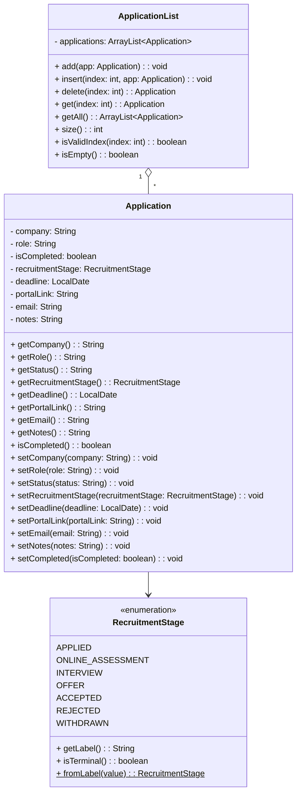

### Add application feature

The `AddCommand` allows job seekers to add a new internship or job record with a company, a role and an optional deadline. It can be reached from menu option `1` or from the typed command `add c/COMPANY r/ROLE [d/YYYY-MM-DD]`.

- **Workflow (menu option `1`)**:
  1. `Main.handleMenuAdd()` queries the user for non-empty company and role strings using `promptNonEmpty()`, followed by optional deadline (`promptDeadline()`), portal link, contact email, and notes (`promptOptional()`). Blank or whitespace-only inputs for required fields are rejected with informative error messages and reprompted.
  2. Once inputs are obtained, `Main` instantiates `AddCommand(company, role, deadline, portalLink, email, notes)`. (For the typed command, `CommandParser.parseAdd()` builds an `AddCommand`.)
  3. `AddCommand.execute()` instantiates a new `Application` with all specified attributes, initializing completion status to `false` (`[ ]`) and recruitment stage to `Applied` (`Application.DEFAULT_STAGE`).
  4. The application is added to `ApplicationList` and remembered by the command so it can be undone. Internal assumptions (such as list size incrementing by 1 and target non-null) are verified via Java `assert`.
  5. The updated list is persisted to disk via `Storage.save(applications)`, and confirmation displaying recorded details is rendered to the user via `Ui.showMessage()`.

#### Add Application Activity Diagram

The user input validation, prompt looping, and execution lifecycle for adding an application is illustrated in the activity diagram below:

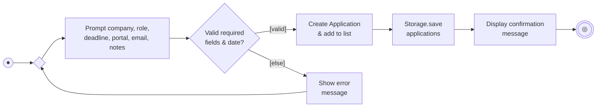

#### Add Application Sequence Diagram

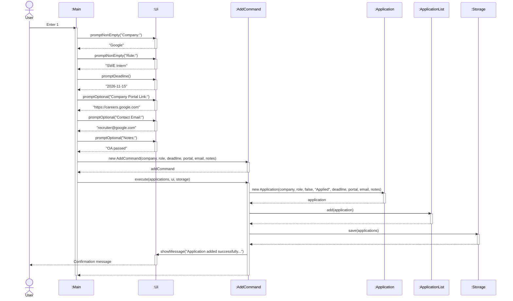

### View application feature

#### Overview
The `ViewCommand` displays all recorded information for an individual application as a structured, visual card. It is executed via the `view <application_number>` standalone command.

#### Design and implementation
- **Parsing**: `ViewCommand.parse(String args)` parses user input following the `view` command prefix. It validates that the argument is a non-empty, positive integer (`1`-based). If the argument is invalid or non-numeric, it throws a `JobSeekException` with helpful usage instructions (`Usage: view INDEX`).
- **Execution**:
  1. `ViewCommand.execute(ApplicationList, Ui, Storage)` validates that the zero-based target index satisfies `0 <= targetIndex < applications.size()`.
  2. If the index is out of bounds, it throws a `JobSeekException` reporting the invalid index and the current list size (e.g., `Application index 5 does not exist. (Total applications: 3)`).
  3. Upon successful bounds validation, it retrieves the target `Application` via `applications.get(targetIndex)`.
  4. It constructs a visual card bordered with dividers, displaying the application's company, role, recruitment stage (`Applied`, `Online Assessment`, `Interview`, `Offer`, `Accepted`, `Rejected`, `Withdrawn`), and completion status (`Yes` or `No`).
  5. The card is rendered via `Ui.showMessage()`.
  6. Because `ViewCommand` is a read-only operation, it does not modify the application list or trigger disk persistence.

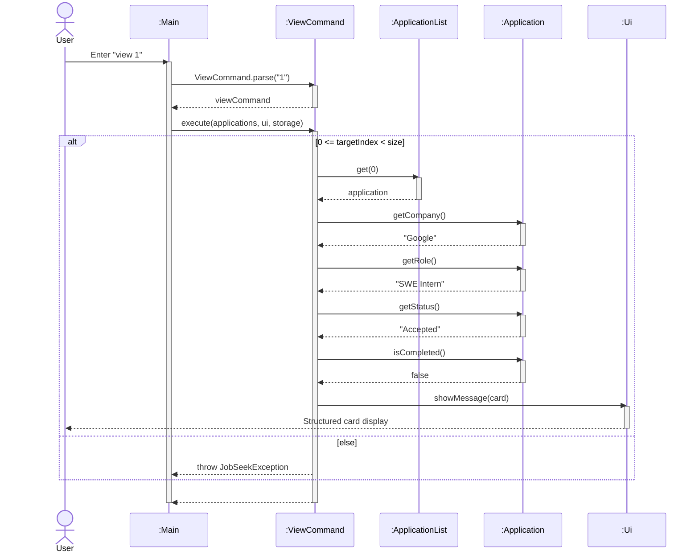

#### Design considerations
- **Card view vs tabular view**:
  - *Current choice*: A structured card view focuses on one record at a time, providing space to cleanly display all recorded attributes (including recruitment status and completion status) without line truncation or horizontal overflow.
  - *Alternative*: Adding more columns to the standard list table. This was rejected because widening the table reduces readability on smaller terminal windows and clutters the overview.
- **Read-only decoupling**:
  - `ViewCommand` adheres to the Command pattern without calling `Storage.save()`, ensuring zero disk I/O overhead.

### Filtered application listing feature

#### Overview
The `ListCommand` presents applications in an aligned ASCII table. It supports completion-status filtering so users can focus on active applications, completed applications, or inspect all tracked opportunities.

#### Design and implementation
- **Filter criteria**: Controlled by the `FilterType` enum:
  - `ACTIVE`: Displays only uncompleted applications (`isCompleted() == false`).
  - `COMPLETED`: Displays only completed applications (`isCompleted() == true`).
  - `ALL`: Displays all applications regardless of completion state.
- **Triggering mechanisms**:
  - Standalone text commands: `list` (defaults to `ACTIVE`), `list completed`, `list all`. Parsed by `ListCommand.parse(String args)`. Unrecognized filters throw a `JobSeekException` with usage instructions.
  - Numeric menu options: Menu option `2` (`List applications`) and menu option `3` (`List uncompleted applications`) both instantiate `ListCommand(FilterType.ACTIVE)`.
- **Workflow**:
  1. `ListCommand.execute()` checks if `applications.isEmpty()`. If the list is empty, it outputs `"No applications found."`.
  2. Iterates over all applications and collects the zero-based indices of matching records into an `ArrayList<Integer> matchingIndices` using `matchesFilter(app)`.
  3. If no records match the chosen filter, context-sensitive feedback is displayed:
     - `COMPLETED`: `"No completed applications found."`
     - `ACTIVE`: `"No active applications found."`
     - `ALL`: `"No applications found."`
  4. Dynamically calculates column widths for `No.`, `Status`, `Company`, `Role`, and `Deadline` based on the longest values among matching entries, guaranteeing clean tabular alignment.
  5. Renders each matching row, preserving the application's original 1-based index (`index + 1`).
  6. Displays the formatted table via `Ui.showMessage()`.

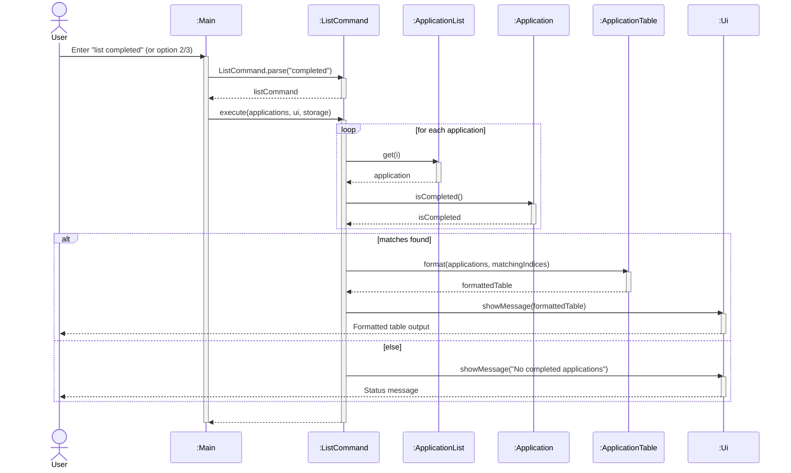

#### Design considerations
- **Preserving original 1-based indices**:
  - *Current choice*: The `No.` column displays the application's original index from `ApplicationList` rather than re-indexing from 1 in the filtered view. This guarantees that numbers remain consistent across `list`, `list completed`, `view`, `mark`, `edit`, and `delete` commands.
  - *Alternative*: Re-numbering matching rows sequentially (1, 2, ...). This was rejected because it introduces confusion when users attempt to execute `view` or `mark` on an application whose display number differs from its list position.
- **Default to active applications**:
  - Job seekers primarily need to review and act upon active, ongoing applications. Concluded applications are hidden by default to keep the interface concise and relevant.

### Mark and unmark application completion feature

#### Overview
The `MarkCommand` allows users to toggle an application's lifecycle between active/incomplete (`[ ]`) and completed (`[X]`). Completed applications are typically archived from the default active list.

#### Design and implementation
- **Menu triggers**:
  - Menu option `5`: Calls `handleMenuMark(true)` to mark an application as completed.
  - Menu option `6`: Calls `handleMenuMark(false)` to unmark an application.
- **Workflow**:
  1. `Main.promptApplicationIndex()` prompts the user for the 1-based application index and converts it to a zero-based integer.
  2. `Main` instantiates `MarkCommand(targetIndex, isCompleted)`.
  3. `MarkCommand.execute(applications, ui, storage)` checks whether `applications.isEmpty()`. If empty, it displays an error message via `Ui.showError()`.
  4. Validates that `targetIndex` is valid using `applications.isValidIndex(targetIndex)`. If invalid, displays a bounds error (e.g., `Invalid application index: 4. Please enter a number between 1 and 2.`).
  5. Retrieves the application and updates its completion state using `application.setCompleted(isCompleted)`.
  6. Displays a confirmation message showing the updated application representation:
     - Marked: `"Nice! I've marked this application as completed:\n  " + application`
     - Unmarked: `"OK, I've marked this application as not completed yet:\n  " + application`
  7. Persists the modification to disk immediately via `Storage.save(applications)`.

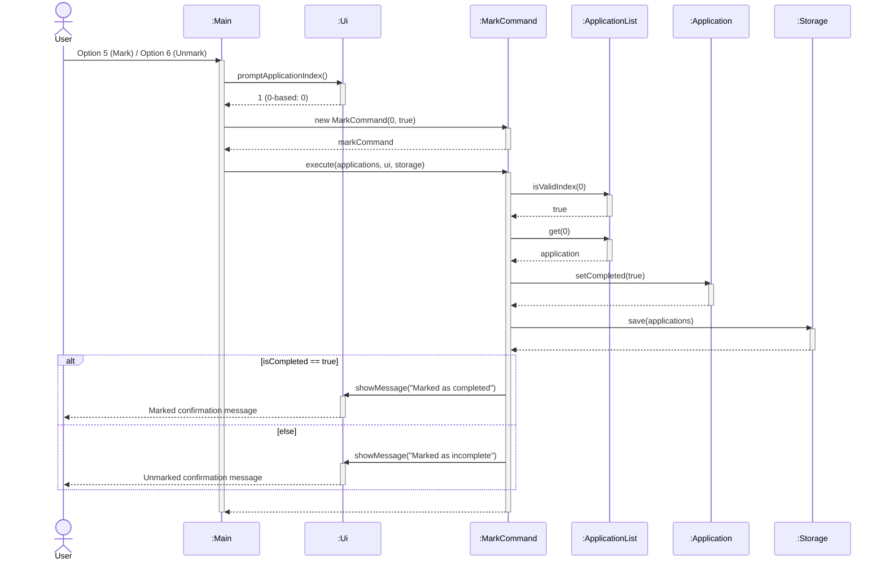

#### Design considerations
- **Single unified command vs separate commands**:
  - *Current choice*: A unified `MarkCommand` parameterized with boolean `isCompleted`. The workflow for validation, index checking, list mutation, and disk persistence is identical for both actions; unifying them eliminates code duplication.
  - *Alternative*: Separate `MarkCommand` and `UnmarkCommand` classes. This was rejected to avoid redundant boilerplate and maintenance overhead.
- **Immediate disk persistence**:
  - Changes to completion status immediately invoke `Storage.save(applications)` to guarantee that completion progress is preserved across application crashes or restarts.

### Delete application feature

#### Overview
The `DeleteCommand` allows users to permanently remove an application by its 1-based index number (as shown in the list table). Removing an application triggers immediate list re-indexing and disk synchronization.

#### Design and implementation
- **Trigger**: Menu option `4` invokes `Main.handleMenuDelete()`.
- **Workflow**:
  1. `Main.promptApplicationIndex()` checks whether `applications.isEmpty()`. If empty, an error is displayed and execution terminates.
  2. Prompts the user for the 1-based index and converts it to a 0-based integer.
  3. `DeleteCommand.execute()` validates index bounds via `applications.isValidIndex(targetIndex)`.
  4. Calls `applications.delete(targetIndex)`, which removes the `Application` from the underlying `ArrayList` and renumbers following elements.
  5. The removed application object is destroyed from in-memory tracking (represented by the UML destruction cross `X` on its lifeline).
  6. The modified list is immediately saved to disk via `Storage.save(applications)`.
  7. A confirmation message displaying the removed entry is shown via `Ui.showMessage()`.

#### Delete Application Activity Diagram

The decision flow, bounds validation, and deletion logic is shown in the activity diagram below:

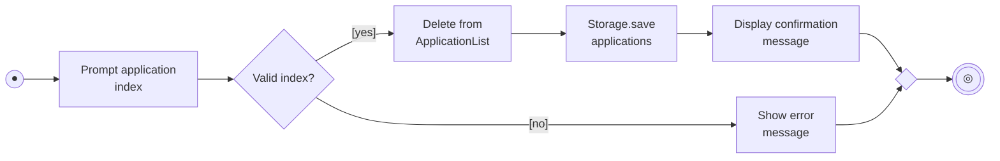

#### Delete Application Sequence Diagram

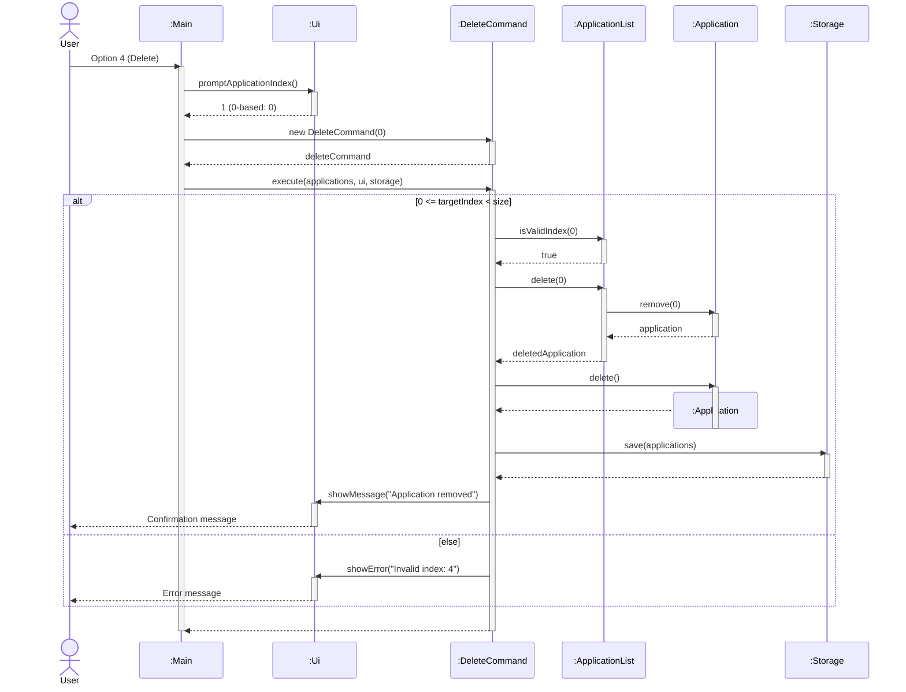

### Edit application and recruitment status tracking

The edit feature allows users to modify existing applications without deleting and re-entering them. Recruitment progress is represented by the `RecruitmentStage` enum (`Applied`, `Online Assessment`, `Interview`, `Offer`, `Accepted`, `Rejected`, `Withdrawn`). The enum owns each display label and whether a stage is terminal. Users may edit a stage freely to handle corrections and different company processes.

- **Design and Implementation**:
  - `EditCommand` accepts a zero-based target index and nullable field replacements: `newCompany`, `newRole`, `newStatus`, `newDeadline`, `newPortalLink`, `newEmail`, and `newNotes`. A `null` value indicates that the corresponding field should remain unchanged.
  - `StatusCommand` provides direct, dedicated recruitment status modification for targeted application records. The menu uses it when only the stage is edited.
  - In `Main.handleMenuEdit()`, the user chooses the target application index, followed by a field choice (1 to 8):
    - `1`: Company only (`EditCommand`)
    - `2`: Role only (`EditCommand`)
    - `3`: Recruitment stage only (`StatusCommand`)
    - `4`: Deadline only (`EditCommand`)
    - `5`: Company Portal Link only (`EditCommand`)
    - `6`: Contact Email only (`EditCommand`)
    - `7`: Notes only (`EditCommand`)
    - `8`: All fields in sequence (Company, Role, Recruitment Stage, Deadline, Portal Link, Email, Notes) (`EditCommand`)
  - The typed command `edit INDEX [c/..] [r/..] [s/..]` is parsed by `CommandParser.parseEdit()` and always creates an `EditCommand`.
  - Stage input normalization in `Main.promptRecruitmentStage()` accepts numbered choices (`1` for Applied, `2` for Online Assessment, `3` for Interview, `4` for Offer, `5` for Accepted, `6` for Rejected, `7` for Withdrawn) and case-insensitive stage names (e.g. `OA`). The legacy label `Pending` is read as `Applied`.
  - Optional fields (deadline, portal link, email, notes) can be updated or cleared with blank inputs.
  - Both commands extend `UndoableCommand` and remember previous values, so `undo` can restore them.
  - **Defensive programming & Assertions**: Java `assert` statements verify preconditions (non-null arguments, in-bounds target indices) and postconditions (non-empty required fields, updated status).

#### Edit Application Activity Diagram

The user interaction and validation workflow for updating application fields is illustrated in the activity diagram below:

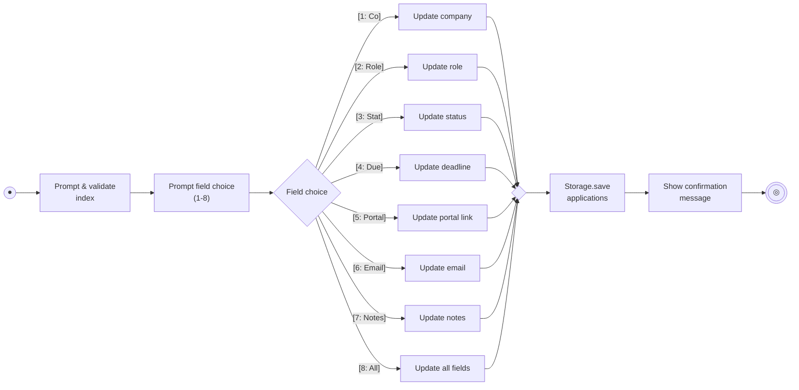

#### Edit Application Sequence Diagram

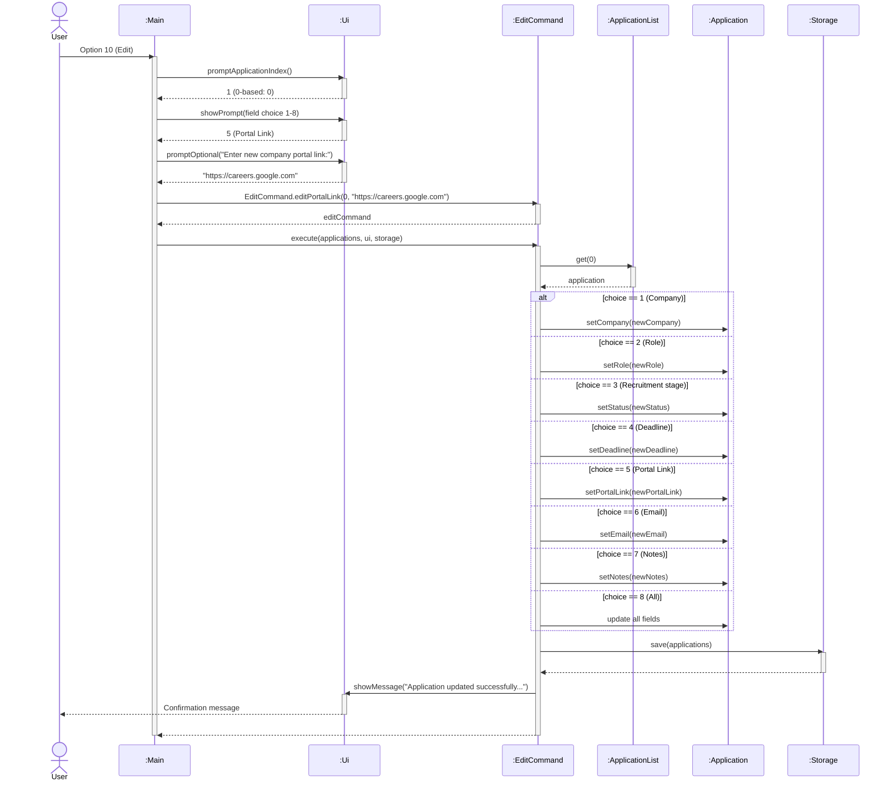

### Help feature

`HelpCommand` displays a summary of the numeric menu options (`[0]` to `[10]`) and of the typed commands (`list`, `undo`, `add`, `edit`, `delete`, `mark`, `unmark`, `find`, `search`, `sort`, `today`, `view`). It extends `Command` and does not change any data or write to disk. Because the help text is a hard-coded string, it must be updated whenever a command is added; `HelpCommandTest` checks for the main entries.

### Search and alphabetical views

`Main` translates numeric menu input into a `Command`. Option `8` asks for a non-blank search term, then creates `SearchCommand`; option `9` creates `SortCommand`. The typed commands `search KEYWORD` and `sort` create the same commands through `CommandParser`. For searches with several conditions, see [Combined filters](#combined-filters-find). Both commands operate on an `ApplicationList` but do not mutate it or call `Storage.save`.

The commands collect zero-based indices of matching applications. `SearchCommand` matches a case-insensitive substring against both company and role. `SortCommand` sorts a copy of the indices by company, then role, using a case-insensitive comparator; original index breaks ties. `ApplicationTable` formats either view with one-based numbers derived from the original indices. This keeps subsequent mark and delete commands unambiguous, even when the display order differs from storage order.

#### Search and Sort Activity Diagram

The flow of user input, matching/sorting logic, and display formatting for both search and sort operations is shown below:

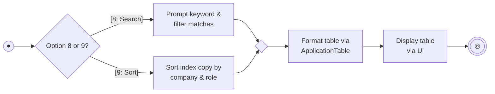

#### Search Sequence Diagram

The interaction sequence for searching applications is shown below:

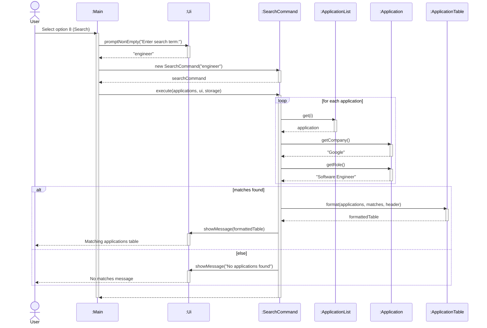

#### Sort Sequence Diagram

The alphabetical view follows a comparable execution path using `SortCommand`. It sorts a copy of the index array rather than mutating storage or the underlying `ApplicationList`:

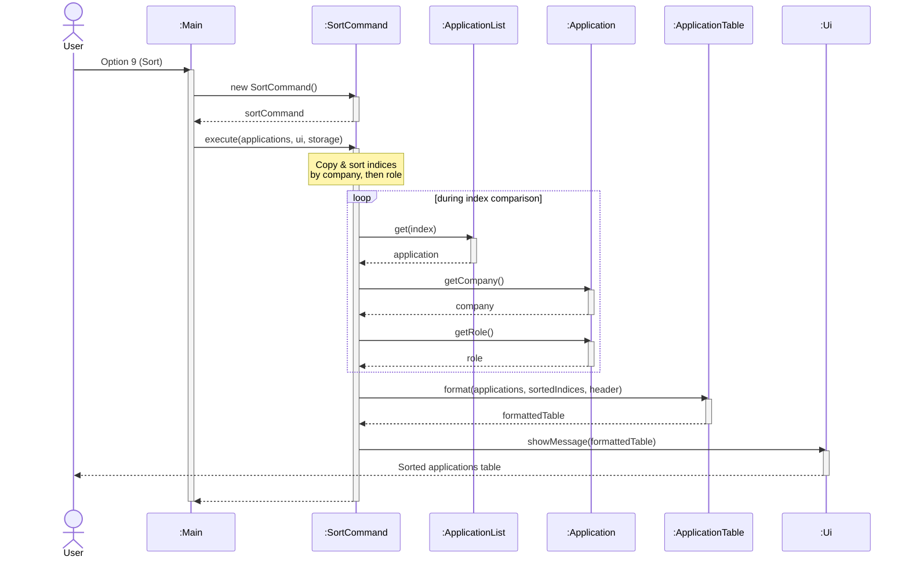

The alphabetical view follows the same formatting path after sorting the index copy. Keeping the list itself unchanged means there is no save operation and existing application numbers remain stable.

### Typed command parser

#### Overview

Besides the numbered menu, users can type a full command on one line, such as `add c/Google r/SWE Intern d/2026-11-30` or `delete 2`. This matches the target user, who types quickly and prefers the keyboard.

#### Design and implementation

`CommandParser` (package `jobseek.parser`) is a utility class with one public method, `parse(String)`. It reads the first word and builds the matching `Command`:

| Input | Command created |
|---|---|
| `add c/.. r/.. [d/..]` | `AddCommand` |
| `edit INDEX [c/..] [r/..] [s/..]` | `EditCommand` |
| `delete INDEX` | `DeleteCommand` |
| `mark INDEX`, `unmark INDEX` | `MarkCommand` |
| `find [c/..] [r/..] [s/..] [b/..] [a/..] [m/..]` | `FindCommand` |
| `search KEYWORD` | `SearchCommand` |
| `sort`, `help`, `exit` | `SortCommand`, `HelpCommand`, `ExitCommand` |

`Main.parseCommand` first handles `view`, `list`, `undo` and `today` itself, then calls `CommandParser.parse`, and finally falls back to the numbered `switch`. The parser returns `null` when the first word is not a typed command (for example `1`), so the menu keeps working unchanged. If the first word is a typed command but its arguments are wrong, the parser throws a `JobSeekException` whose message contains the correct usage, and `Main` shows it as an error.

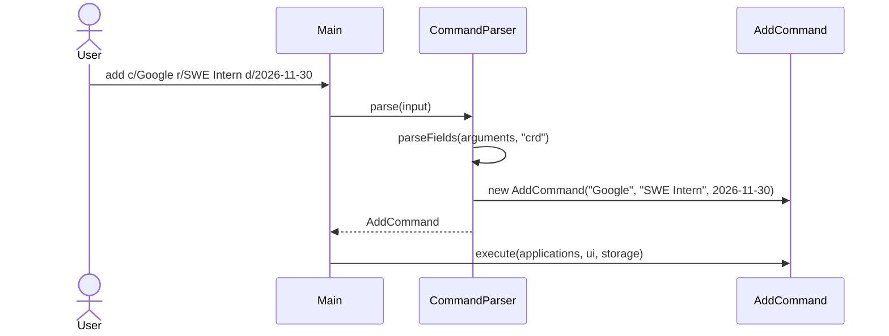

Fields are found with the regular expression `(?:^|\s)([a-z])/`, which matches a single letter and a slash at the start of the text or after whitespace. Everything between one prefix and the next is that field's value, so values can contain spaces. Text before the first prefix is kept separately; `edit` treats it as the index, and `add` and `find` reject it. Because the prefix must follow whitespace, slashes inside words such as `AT&T/Intel` are ordinary text. The parser also rejects unknown prefixes, repeated prefixes and empty values.

User-typed indexes are one-based, and the parser converts them to the zero-based indexes that commands expect. A stage typed after `s/` is validated with `RecruitmentStage.fromLabel` so a typo is reported as a normal error before any command runs.

#### Design considerations

* **Separate class vs. more code in `Main`:** `Main` already held all the menu prompting. Putting parsing in its own class keeps `Main` smaller and lets the parser be unit-tested without simulating console input (`CommandParserTest`).
* **Prefix syntax vs. positional arguments:** with `add Google SWE Intern` it is impossible to tell where the company name ends. Prefixes allow multi-word values and any field order.
* **Limitation:** a value cannot contain a space followed by a single letter and a slash (for example ` r/`).

### Combined filters (`find`)

#### Overview

`find` lets the user combine several conditions, for example `find c/google s/interview a/2026-11-01`. The existing `search` command only matches one keyword against company or role, which is not enough once there are dozens of applications.

#### Design and implementation

| Class | Responsibility |
|---|---|
| `ApplicationFilters` (`model`) | Static factory methods such as `companyContains`, `inStage` and `deadlineOnOrBefore`. Each returns a `Predicate<Application>`. |
| `CommandParser` (`parser`) | `parseFind` turns each prefix (`c/ r/ s/ b/ a/ m/`) into a predicate and joins them with `Predicate.and`. It also builds a readable description of the conditions. |
| `FindCommand` (`command`) | Holds one combined `Predicate<Application>` and a description. It tests every application, then shows the matches through `ApplicationTable`. |

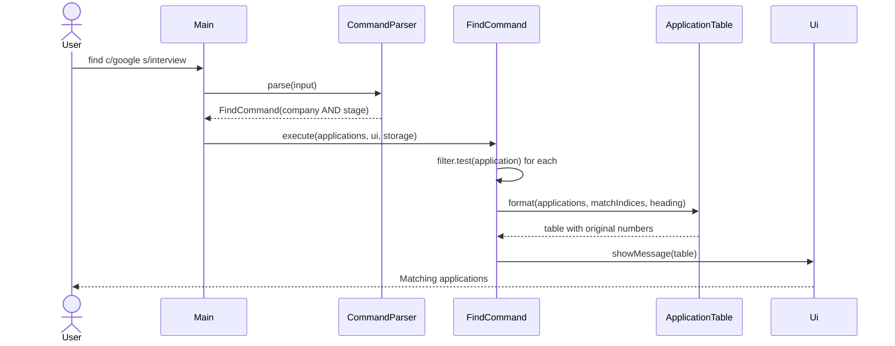

`FindCommand` never needs to know which filters were chosen, because the parser has already combined them into a single predicate. Adding a new filter therefore means adding one factory method to `ApplicationFilters` and one prefix to `parseFind`; `FindCommand` stays unchanged. This is the strategy pattern, using Java's functional interface `Predicate` instead of a hand-written interface. `FindCommand` is read-only, so it does not call `Storage.save`.

#### Design considerations

* **Predicates vs. one method with many `if` statements:** a single method checking six optional parameters grows with every new filter and is hard to test. Small predicates are tested one by one (`FindCommandTest`) and combined freely.
* **`and` only:** all filters must match. Supporting `or` would need a more complex syntax, so it is left out.
* **Applications without a deadline** never match `b/` or `a/`, because "unknown" is not before or after any date.
* **Original numbering:** results use the index in the full list (like `search` and `sort`), so numbers stay valid for `edit` and `delete`.

### Delete confirmation and undo

#### Overview

`DeleteCommand` asks the user to confirm before removing an application, and `undo` reverses the most recent change. Both exist to protect the user from slips: the data file is overwritten on every save, so a mistaken delete would otherwise be permanent.

#### Design and implementation

| Class | Responsibility |
|---|---|
| `UndoableCommand` | Abstract subclass of `Command` that adds `undo(ApplicationList)` and a `hasChanged()` flag. |
| `AddCommand`, `DeleteCommand`, `EditCommand`, `StatusCommand`, `MarkCommand` | Extend `UndoableCommand`. Each remembers what it needs (the affected `Application` and its old values) while executing. |
| `CommandHistory` | A stack (`ArrayDeque`) of undoable commands that actually changed the list. |
| `UndoCommand` | Pops the newest command, calls its `undo`, shows what was undone and saves. |
| `Main` | Owns the `CommandHistory`, records each executed command, and creates `UndoCommand` for the text command `undo`. |

```mermaid
classDiagram
    Command <|-- UndoableCommand
    Command <|-- UndoCommand
    UndoableCommand <|-- AddCommand
    UndoableCommand <|-- DeleteCommand
    UndoableCommand <|-- EditCommand
    UndoableCommand <|-- StatusCommand
    UndoableCommand <|-- MarkCommand
    CommandHistory o-- UndoableCommand
    UndoCommand --> CommandHistory
    class UndoableCommand {
        <<abstract>>
        +undo(applications)* String
        +hasChanged() boolean
    }
    class CommandHistory {
        -Deque~UndoableCommand~ history
        +record(command) void
        +pop() UndoableCommand
        +isEmpty() boolean
    }
```

```mermaid
sequenceDiagram
    actor User
    participant Main
    participant DeleteCommand
    participant CommandHistory
    participant UndoCommand
    participant ApplicationList
    User->>Main: delete 2
    Main->>DeleteCommand: execute(applications, ui, storage)
    DeleteCommand->>User: Delete [ ] Google | SWE Intern? (y/n)
    User-->>DeleteCommand: y
    DeleteCommand->>ApplicationList: delete(1)
    Main->>CommandHistory: record(deleteCommand)
    User->>Main: undo
    Main->>UndoCommand: execute(applications, ui, storage)
    UndoCommand->>CommandHistory: pop()
    CommandHistory-->>UndoCommand: deleteCommand
    UndoCommand->>DeleteCommand: undo(applications)
    DeleteCommand->>ApplicationList: insert(1, deletedApplication)
```

Confirmation happens inside `DeleteCommand.execute` by calling `ui.readCommand()`, so it applies however the command was created (menu option `4` or the typed `delete INDEX`). Only `y` or `yes` (case-insensitive) confirms; anything else, including end of input, cancels.

Undo works on the same `Application` objects that were changed. Commands keep a reference plus the previous values, so an undo is exact even when two applications look identical (`AddCommand.undo` compares by identity, not `equals`). `DeleteCommand.undo` uses `ApplicationList.insert(index, app)` to restore the original position.

#### Design considerations

* **Command history vs. snapshots:** storing a copy of the whole list after each change is simpler but wastes memory and would hide which change was undone. Per-command undo gives a precise message and fits the existing Command pattern.
* **`hasChanged()`:** rejected commands (invalid index, cancelled delete) never call `markChanged()`, so they are not recorded and `undo` never reverts something that did not happen.
* **Limitations:** history is in memory only and there is no redo.

### Today dashboard

`TodayCommand` shows overdue, due-today and upcoming (next 7 days) deadlines of active applications, then a summary (active/completed counts, active applications per recruitment stage). `Main.parseCommand` creates it for the text command `today`.

It is read-only, so it does not call `Storage.save`. Its constructor accepts a `LocalDate` so tests can fix "today"; the no-argument constructor uses `LocalDate.now()`. Each entry prints the application's original one-based index so it can be used with `view`, `edit` and `delete`. The classification rules match `DeadlineWarnings` (same 7-day window, completed applications ignored), but the dashboard can be run on demand instead of only at startup.

**Alternative considered:** reuse `DeadlineWarnings` directly. It was not reused because it builds a single text block with no per-section counts or summary; extracting a shared classifier is a possible later refactoring.

### Startup deadline warnings

#### Overview

The startup deadline warnings feature helps users identify applications that require attention when they launch JobSeek. It displays a summary of overdue deadlines, deadlines due today, and deadlines within the next seven days.

Warnings apply only to applications that have not been marked as completed. Applications without a recorded deadline are excluded. This allows users to track applications even when their deadlines are unknown.

For example, if the current date is `2026-10-28`, an incomplete application with a deadline of `2026-10-27` is classified as `OVERDUE`, while one with a deadline of `2026-10-30` is classified as `UPCOMING`.

#### Design and implementation

The feature involves the following classes:

| Class | Responsibility |
|---|---|
| `Main` | Coordinates startup and invokes the deadline check before displaying the menu. |
| `DeadlineWarnings` | Selects applications requiring attention and builds the warning summary. |
| `ApplicationList` | Provides access to the stored application records. |
| `Application` | Stores the optional deadline and completion flag for each application. |
| `Ui` | Displays the warning summary to the user. |

The following class diagram shows the relationships relevant to deadline checking. Unrelated fields and methods are omitted.

```mermaid
classDiagram
    direction TB

    class Main {
        + run(): void
    }

    class DeadlineWarnings {
        - UPCOMING_WINDOW_DAYS: int$
        + show(applications: ApplicationList, ui: Ui): void
        - appendWarning(warnings: StringBuilder, application: Application, deadline: LocalDate, today: LocalDate): void
    }

    class ApplicationList {
        + size(): int
        + get(index: int): Application
    }

    class Application {
        + getDeadline(): LocalDate
        + isCompleted(): boolean
    }

    class Ui {
        + showMessage(message: String): void
    }

    Main "1" --> "1" DeadlineWarnings : invokes
    DeadlineWarnings "1" ..> "1" ApplicationList : reads
    ApplicationList "1" *-- "0..*" Application : contains
    DeadlineWarnings "1" ..> "0..*" Application : inspects
    DeadlineWarnings "1" ..> "1" Ui : displays summary
```

Each application's deadline is represented using `LocalDate`. A `null` deadline indicates that no deadline has been recorded. `LocalDate` supports comparisons between calendar dates without requiring a time of day.

During normal startup, `Main` loads saved applications through `Storage` before `run()` begins. Within `run()`, it displays the welcome message, calls `DeadlineWarnings.show(applications, ui)`, and then displays the menu.

`DeadlineWarnings.show()` obtains the current date once using `LocalDate.now()`. It then iterates through the applications and excludes any record that:

- Has been marked as completed.
- Has no recorded deadline.
- Has a deadline later than seven days after the current date.

The remaining applications are classified using the following rules:

| Deadline relative to today | Classification |
|---|---|
| Earlier than today | `OVERDUE` |
| Equal to today | `DUE TODAY` |
| After today, up to and including seven days away | `UPCOMING` |

The seven-day boundary is inclusive. For example, when today is `2026-10-28`, a deadline of `2026-11-04` is included, while `2026-11-05` is excluded. There is no lower date limit for overdue applications.

The private `appendWarning()` method adds each warning to a `StringBuilder`. Each entry contains its classification, company, role and deadline. After checking all applications, `show()` displays the accumulated summary through a single call to `Ui.showMessage()`. If no applications qualify, it displays no warning message.

#### Sequence of interactions

The following sequence diagram illustrates the deadline check after saved applications have been loaded. Warning classification and formatting are summarised in a note to keep the diagram focused on interactions between objects.

```mermaid
---
config:
  themeCSS: ".actor-line { stroke-dasharray: 4, 4 !important; } line.loopLine:not([style*='stroke-dasharray']) { stroke-dasharray: none !important; }"
---
sequenceDiagram
    participant main as :Main
    participant ui as :Ui
    participant warnings as :DeadlineWarnings
    participant list as :ApplicationList
    participant app as :Application

    activate main
    main->>ui: showWelcome()
    activate ui
    ui-->>main: ​
    deactivate ui

    main->>warnings: show(applications, ui)
    activate warnings
    Note over warnings: Obtain today's date<br/>via LocalDate.now()

    loop for each application
        warnings->>list: get(i)
        activate list
        list-->>warnings: application
        deactivate list
        warnings->>app: getDeadline()
        activate app
        app-->>warnings: deadline
        deactivate app
        warnings->>app: isCompleted()
        activate app
        app-->>warnings: completed
        deactivate app

        opt incomplete and deadline <= today + 7 days
            Note over warnings: Classify deadline and append warning
        end
    end

    opt warning summary is not empty
        warnings->>ui: showMessage(summary)
        activate ui
        ui-->>warnings: ​
        deactivate ui
    end

    warnings-->>main: ​
    deactivate warnings
    main->>ui: showMenu(applications)
    activate ui
    ui-->>main: ​
    deactivate ui
    deactivate main
```

#### Design considerations

**Separate warning logic from startup coordination.**  
`Main` controls when the check occurs, while `DeadlineWarnings` handles selection and classification. This keeps deadline rules in one class and allows them to be changed without expanding the startup workflow. An alternative would be to place the entire check inside `Main.run()`, but that would give `Main` additional responsibility for deadline processing.

**Derive warnings from application data.**  
Warning classifications are calculated from the deadline and current date whenever the application starts. They are not stored separately. This avoids persisting a classification such as `UPCOMING` that could become outdated as time passes.

**Display one consolidated summary.**  
Accumulating warnings before displaying them groups all relevant deadlines together. It also keeps the output operation separate from the iteration over application records.

#### Current limitations and possible extensions

The check runs once at startup. Warnings do not automatically refresh after an application is added or when the date changes while JobSeek remains open. The `today` command (see [Today dashboard](#today-dashboard)) provides an on-demand view with the same rules, but the startup warnings themselves are still produced only once.

The upcoming window is currently fixed at seven days through `UPCOMING_WINDOW_DAYS`. It could later become configurable.

The implementation uses the system's current date directly. A future improvement could inject a `Clock` to make date-boundary tests independent of the day on which they run.

### Local storage

#### Overview

The local storage feature preserves application records between JobSeek sessions. Applications are saved to `data/applications.txt` and loaded when the program starts.

The `Storage` class handles file access and conversion between application objects and their text representation. This keeps file-handling details separate from command execution and user interaction.

#### Design and implementation

The feature involves the following classes:

| Class | Responsibility |
|---|---|
| `Storage` | Reads and writes application records in the local data file. |
| `ApplicationList` | Holds the application records in memory. |
| `Application` | Represents an individual application and its stored fields. |
| `Main` | Loads saved records during startup and reports loading errors. |

`Storage` uses `data/applications.txt` by default. Its constructor also accepts a custom file path, allowing tests to use temporary files without modifying the user's saved data.

The class relationships within the storage subsystem are illustrated below:

```mermaid
classDiagram
    direction TB

    class Storage {
        - filePath: String
        - TITLE_HEADER: String$
        - COLUMN_HEADER: String$
        + save(applications: ApplicationList): void
        + load(): ApplicationList
        - escape(value: String)$: String
        - splitFields(line: String)$: List~String~
    }

    class ApplicationList {
        - applications: ArrayList~Application~
        + getAll(): List~Application~
        + add(application: Application): void
    }

    class Application {
        - company: String
        - role: String
        - isCompleted: boolean
        - status: String
        - deadline: LocalDate
        - portalLink: String
        - email: String
        - notes: String
        + getCompany(): String
        + getRole(): String
        + isCompleted(): boolean
        + getStatus(): String
        + getDeadline(): LocalDate
        + getPortalLink(): String
        + getEmail(): String
        + getNotes(): String
    }

    class Main {
        + loadApplications(): ApplicationList
    }

    Main "1" --> "1" Storage : uses
    Storage "1" ..> "1" ApplicationList : saves / loads
    ApplicationList "1" *-- "0..*" Application : contains
    Storage "1" ..> "0..*" Application : serializes / parses
```

#### File format

The file uses UTF-8 encoding and contains two header lines followed by application records. Each record contains eight tab-separated fields:

| Field | Representation |
|---|---|
| Company | Escaped text |
| Role | Escaped text |
| Completion flag | `true` or `false` |
| Deadline | ISO date such as `2026-11-03`, or an empty field |
| Recruitment stage | Escaped text such as `Applied`; an empty field is read as `Applied` |
| Company portal link | Escaped URL text, or an empty field |
| Contact email | Escaped email address, or an empty field |
| Notes | Escaped freeform text, or an empty field |

An empty deadline, portal link, email, or notes field represents an application where that optional attribute has not been recorded.

Backslashes, tabs, newlines and carriage returns within text fields are escaped (`\\`, `\t`, `\n`, `\r`) before saving. During loading, `splitFields()` decodes these escape sequences. This prevents characters inside company, role, or notes from being mistaken for field or record separators.

**Backward compatibility:** Files written by earlier versions have four fields (legacy, without status) or five fields (prior stage format). `Storage.load()` accepts four-field, five-field, and modern eight-field records. Four-field records receive the default `Applied` stage, and existing `Pending` values automatically migrate to `Applied`. Missing portal link, email, and notes default to empty strings. The next save rewrites the file in the full eight-field format.

#### Saving applications

Commands that modify application data call `Storage.save(applications)` to persist the updated list.

The save operation performs the following steps:

1. Converts the configured file path into a `Path`.
2. Creates missing parent directories, if required.
3. Adds the title and column headers.
4. Converts each application into a tab-separated record.
5. Writes the complete contents using UTF-8 encoding.

The sequence of interactions during a save operation is shown below:

```mermaid
---
config:
  themeCSS: ".actor-line { stroke-dasharray: 4, 4 !important; } line.loopLine:not([style*='stroke-dasharray']) { stroke-dasharray: none !important; }"
---
sequenceDiagram
    participant cmd as :Command
    participant storage as :Storage
    participant list as :ApplicationList
    participant app as :Application

    activate cmd
    cmd->>storage: save(applications)
    activate storage
    storage->>list: getAll()
    activate list
    list-->>storage: applicationList
    deactivate list

    loop for each application
        storage->>app: getCompany()
        activate app
        app-->>storage: company
        deactivate app
        storage->>app: getRole()
        activate app
        app-->>storage: role
        deactivate app
        storage->>app: isCompleted()
        activate app
        app-->>storage: isCompleted
        deactivate app
        storage->>app: getDeadline()
        activate app
        app-->>storage: deadline
        deactivate app
    end

    Note over storage: Encode records &<br/>write UTF-8 lines to disk
    storage-->>cmd: ​
    deactivate storage
    deactivate cmd
```

The operation rewrites the file using the current list. Consequently, applications removed from the list are also removed from the saved data.

#### Loading applications

During normal startup, `Main` calls `Storage.load()` before entering the main interaction loop.

If the file does not exist, `load()` returns an empty `ApplicationList`. Otherwise, it reads the file and processes each line. Blank lines, comment lines beginning with `#`, and recognised header lines are ignored.

For each application record, `Storage` checks that there are four fields (older files) or five fields, that the completion flag is either `true` or `false`, that company and role are not blank, and that the stage is a known `RecruitmentStage`. A non-empty deadline is parsed using `LocalDate.parse()`. Valid records are reconstructed as `Application` objects and added to the list. A record that fails any check is skipped and a message is added to the warnings returned by `Storage.getLoadWarnings()`.

The following sequence diagram shows successful loading of an existing file. File-reading details are summarised in a note:

```mermaid
---
config:
  themeCSS: ".actor-line { stroke-dasharray: 4, 4 !important; } line.loopLine:not([style*='stroke-dasharray']) { stroke-dasharray: none !important; }"
---
sequenceDiagram
    participant main as :Main
    participant storage as :Storage
    participant list as :ApplicationList
    participant app as :Application
    participant ui as :Ui

    activate main
    main->>storage: load()
    activate storage
    Note over storage: Read UTF-8 file if it exists

    storage->>list: new ApplicationList()
    activate list
    list-->>storage: applications
    deactivate list

    loop each line of the file
        Note over storage: Decode fields and validate record
        alt record is valid
            storage->>app: new Application(co, role, done, stage, date, portal, email, notes)
            activate app
            app-->>storage: application
            deactivate app
            storage->>list: add(application)
            activate list
            list-->>storage: ​
            deactivate list
        else record is corrupted
            Note over storage: Skip record and remember warning
        end
    end
    storage-->>main: applications
    deactivate storage

    main->>storage: getLoadWarnings()
    activate storage
    storage-->>main: warnings
    deactivate storage
    loop each warning
        main->>ui: showError(warning)
        activate ui
        ui-->>main: ​
        deactivate ui
    end
    deactivate main
```

#### Error handling

JobSeek recovers from corrupted lines instead of discarding the whole file. If a line has an invalid escape sequence, the wrong number of fields, an invalid completion flag, an empty company or role, an invalid deadline or an unknown stage, `load()` skips that line and records a warning that names the line number. All other valid lines are still loaded.

After loading, `Main.loadApplications()` shows each warning through `Ui.showError()`. Only an unrecoverable problem (for example the file cannot be read at all) makes `load()` throw an exception; `Main` then shows an error and starts with an empty list.

Skipped lines are not rewritten until the next save, and the next save writes only the records that loaded. Users who want to repair a corrupted line should fix the file by hand before making further changes.

Saving errors propagate to the caller. During command execution, `Main` catches these errors and displays an error message.

#### Design considerations

**Human-readable text format.**  
The tab-separated format is simple to inspect and uses Java's standard file APIs. An alternative would be JSON, which could represent additional fields more explicitly but would require a different serialisation approach.

**Save the complete list.**  
Rewriting the complete list keeps persistence straightforward because additions, updates and deletions use the same save operation. The trade-off is that each save processes every application.

**Separate persistence from application logic.**  
Commands request a save without implementing file encoding or parsing themselves. Changes to the storage format can therefore be concentrated in `Storage`.

#### Possible improvements

Saving could use a temporary file followed by an atomic replacement to reduce the risk of an interrupted write damaging the existing data file.

When lines are skipped during loading, the next save permanently removes them from the file. A future version could keep a backup of the original file (for example `applications.txt.bak`) before the first save after a recovery.

## Product scope

### Target user profile

University students who apply for several internships and graduate roles at the same time, and who:

* are comfortable typing and prefer a keyboard to a mouse;
* manage their applications alone on their own computer;
* are comfortable running a Java program from a terminal.

### Value proposition

Application information is usually spread across company portals, emails, notes and memory. JobSeek keeps one personal, human-editable record of every application's company, role, recruitment stage, deadline and completion state. Students can capture an application in one line, see what needs attention today, find applications quickly when the list grows, and undo mistakes.

## User Stories

| Version | As a ... | I want to ... | So that I can ... |
|---|---|---|---|
| v1.0 | student beginning to track applications | add a new job application | keep an opportunity in one central record |
| v1.0 | new user | see usage instructions | refer to them when I forget how to use the application |
| v1.0 | job seeker | view detailed information of a specific application | inspect all fields including recruitment stage and completion state in a structured card |
| v1.0 | job seeker | mark an application as completed | track which applications have concluded their recruitment cycle |
| v1.0 | job seeker | unmark a completed application | reopen an application if the recruitment process resumes or if marked by mistake |
| v2.0 | job seeker | find applications by company or role | locate an application without scanning the full list |
| v2.0 | job seeker | view applications alphabetically | compare applications by company and role more easily |
| v2.0 | job seeker | filter applications by active or completed status | focus on ongoing applications without distraction from completed ones |
| v2.0 | student | edit the recorded details of an application | keep information accurate when details change or I make a mistake |
| v2.0 | student | record the current recruitment stage of an application | track my current progress for the application |
| v2.0 | student with many deadlines | be warned about overdue and upcoming deadlines when the program starts | avoid missing a deadline after a busy period |
| v2.0 | student | see a dashboard of what needs attention today | decide what to do next without reading every record |
| v2.0 | student | keep my applications and their stages between sessions | avoid re-entering data every time |
| v2.0 | student | have the program keep working if part of my data file is damaged | avoid losing all my records because of one bad line |
| v2.0 | fast typist | add, edit, delete and mark applications with one-line commands | work faster than answering prompts one by one |
| v2.0 | student with many applications | combine company, role, stage, deadline and completion filters | narrow a long list down to the few I need |
| v2.0 | careless typist | confirm before deleting and undo my last change | recover from mistakes |

## Non-Functional Requirements

1. Should work on Windows, Linux and macOS with Java 25 installed, without an installer.
2. Should store data only in a local, human-editable text file; no database and no remote server.
3. Should be used by one user at a time on a personal computer.
4. Should respond to any command in under one second with up to 500 applications.
5. A user who types quickly should be able to complete the main tasks (add, edit, delete, mark, find) faster by typing one-line commands than with a mouse-driven interface.
6. A damaged line in the data file should not prevent the remaining valid records from loading.
7. The packaged JAR should be 100 MB or smaller.

## Glossary

* *Application* - A record of one internship or job application: company, role, recruitment stage, optional deadline and completion state.
* *Recruitment stage* - Where an application is in the hiring process: Applied, Online Assessment, Interview, Offer, Accepted, Rejected or Withdrawn.
* *Active application* - An application that is not marked as completed.
* *Completed application* - An application marked with `[X]`, hidden from the default `list`.
* *Deadline* - The date by which the user must take the next action for an application.
* *Index* - The number shown beside an application in `list`, `search`, `sort` and `find`; it is 1-based and stays the same in filtered views.
* *Menu option* - A number (`0`-`10`) that starts a prompt-based action.
* *Typed command* - A one-line command such as `add c/Google r/SWE` or `find s/interview`.
* *Prefix* - A letter and slash, such as `c/`, that marks the start of a field in a typed command.

## Instructions for manual testing

These steps assume you start from a clean state. Delete `data/applications.txt` (if it exists) before launching JobSeek with `java -jar jobseek.jar`. The expected outputs are examples; wording of table spacing may differ slightly. It includes realistic input sequences, edge cases, and exact code examples of the expected console output.

### Adding an application

1. Launch JobSeek with an empty list.
2. Select `1`. When prompted for `Company:`, press Enter without typing. Confirm error appears and prompt repeats:
   ```text
   Error: Company cannot be empty. Please enter a valid company name:
   ```
3. Enter `Google`. When prompted for `Role:`, enter `SWE Intern`. When prompted for optional fields (`Deadline:`, `Company Portal Link:`, `Contact Email:`, `Notes:`), press Enter to skip each. Confirm confirmation message:
   ```text
   Application added successfully.
   Company: Google
   Role: SWE Intern
   ```
4. Add another application with all optional fields: enter `1`, company `Microsoft`, role `Cloud Engineer`, deadline `2026-11-15`, portal link `https://careers.microsoft.com`, contact email `recruiter@microsoft.com`, and notes `First screening completed`:
   ```text
   Application added successfully.
   Company: Microsoft
   Role: Cloud Engineer
   Deadline: 2026-11-15
   Portal Link: https://careers.microsoft.com
   Email: recruiter@microsoft.com
   Notes: First screening completed
   ```
5. Choose `2` to list applications. Confirm the new records appear in the active applications table.

### Viewing help instructions

1. Enter `7` from the main menu.
2. Verify that all menu options `[0]` through `[10]` and the typed commands (`list`, `undo`, `add`, `edit`, `delete|mark|unmark`, `find`, `search`, `sort`, `today`, `view`) are displayed:
   ```text
   Available menu options:
     list [completed|all]            - List active, completed, or all applications
     undo                            - Undo the last add, delete, edit, status or mark change
     add c/COMPANY r/ROLE [d/DATE]   - Add an application in one line
     edit INDEX [c/..] [r/..] [s/..] - Edit company, role or stage in one line
     delete|mark|unmark INDEX        - Delete, complete or reopen an application
     find c/.. r/.. s/.. b/.. a/..   - Combine filters (company, role, stage, deadline)
     search KEYWORD | sort           - Search by company/role, or view alphabetically
     today                           - Show overdue, due-today and upcoming deadlines
     view INDEX                      - View details for application at INDEX
     [1] Add application             - Add a new internship or job application
     [2] List applications           - View active applications in a numbered table
     [3] List uncompleted apps       - View active / uncompleted applications
     [4] Delete application          - Delete an application by index
     [5] Mark application completed  - Mark an application as completed
     [6] Unmark application          - Mark an application as not completed
     [7] Help                        - Show this help message
     [8] Search applications         - Find applications by company or role
     [9] Sort applications           - View applications alphabetically
     [10] Edit application           - Edit an existing application's details
     [0] Exit                        - Exit JobSeek
   ```
3. Type `help` and verify that the same list is shown.

### Viewing application details

1. Start JobSeek and add an application with company `Google` and role `SWE Intern`.
2. Enter `view 1`. Confirm that a structured details card appears:
   ```text
   ==================================================
   Application Details [Index: 1]
   --------------------------------------------------
   Company:   Google
   Role:      SWE Intern
   Status:    Applied
   Completed: No
   ==================================================
   ```
3. Test invalid and boundary inputs:
   - Enter `view` (no index). Confirm error:
     ```text
     Error: Please provide a valid positive application index. Usage: view INDEX
     ```
   - Enter `view 0` or `view -1`:
     ```text
     Error: Please provide a valid positive application index. Usage: view INDEX
     ```
   - Enter `view abc`:
     ```text
     Error: Please provide a valid positive application index. Usage: view INDEX
     ```
   - Enter `view 99` (out of bounds):
     ```text
     Error: Application index 99 does not exist. (Total applications: 1)
     ```

### Listing and filtering applications

1. Start JobSeek with an empty list. Choose `2` or type `list`. Confirm empty message appears:
   ```text
   No applications found.
   ```
2. Add three applications:
   - Application 1: `Google / SWE Intern`
   - Application 2: `Shopee / Backend Intern`
   - Application 3: `GovTech / Fullstack Developer`
3. Mark Application 2 as completed using option `5`.
4. Test active filter (default): Choose `2` (or option `3`, or type `list`). Confirm only active applications appear with original numbers:
   ```text
   Active applications:
   No. | Status | Company | Role
   ----+--------+---------+---------------------
   1   | [ ]    | Google  | SWE Intern
   3   | [ ]    | GovTech | Fullstack Developer
   ```
5. Test completed filter: Type `list completed`. Confirm only Application 2 appears:
   ```text
   Completed applications:
   No. | Status | Company | Role
   ----+--------+---------+---------------
   2   | [X]    | Shopee  | Backend Intern
   ```
6. Test all filter: Type `list all`. Confirm all three applications appear:
   ```text
   All applications:
   No. | Status | Company | Role
   ----+--------+---------+---------------------
   1   | [ ]    | Google  | SWE Intern
   2   | [X]    | Shopee  | Backend Intern
   3   | [ ]    | GovTech | Fullstack Developer
   ```
7. Test unrecognized filter: Type `list pending`. Confirm error appears:
   ```text
   Error: Invalid list filter: 'pending'. Usage: list [completed|all]
   ```

### Marking and unmarking applications

1. Have at least one uncompleted application (e.g. Application 1 `[ ] Google`).
2. Choose option `5` (Mark completed). Enter `1`. Confirm confirmation message:
   ```text
   Nice! I've marked this application as completed:
     [X] Google | SWE Intern
   ```
3. Type `list`. Confirm Application 1 is no longer in the active list.
4. Type `list completed`. Confirm Application 1 appears with status `[X]`.
5. Choose option `6` (Unmark). Enter `1`. Confirm confirmation message:
   ```text
   OK, I've marked this application as not completed yet:
     [ ] Google | SWE Intern
   ```
6. Type `list`. Confirm Application 1 reappears in the active list with `[ ]`.
7. Test invalid inputs for marking and unmarking:
   - Enter non-numeric input `xyz` at the index prompt:
     ```text
     Error: Invalid application index. Please enter a valid number.
     ```
   - Enter out-of-bounds index `99`:
     ```text
     Error: Invalid application index: 99. Please enter a number between 1 and 3.
     ```

### Deleting an application

1. Start JobSeek with an empty application list and choose `4`. Confirm empty error:
   ```text
   Error: Your application list is currently empty.
   ```
2. Add two applications: Application 1 (`Google / SWE Intern`) and Application 2 (`Shopee / Backend Intern`).
3. Choose `4` (Delete) and enter `1`. Confirm deletion confirmation message:
   ```text
   OK, I've deleted this application:
     [ ] Google | Role: SWE Intern
   ```
4. Choose `2` to list applications. Confirm only Application 2 remains (now at list index 1).
5. Choose `4` and enter out-of-bounds index `5`:
   ```text
   Error: Invalid application index: 5. Please enter a number between 1 and 1.
   ```

### Editing application fields

1. Start JobSeek with an empty application list and choose `10`. Confirm error appears:
   ```text
   Error: Your application list is currently empty.
   ```
2. Add an application using `1` with company `Googl` and role `SWE Intern`.
3. Choose `10` and enter application index `1`.
4. Choose `1` (Company). Enter `Google`. Confirm confirmation output displays updated company:
   ```text
   Application updated successfully.
   Company: Google
   Role: SWE Intern
   Status: Applied
   ```
5. Choose `10` and enter index `1`. Choose `2` (Role). Enter `Backend Intern`. Confirm updated role:
   ```text
   Application updated successfully.
   Company: Google
   Role: Backend Intern
   Status: Applied
   ```
6. Choose `10`, index `1`, and field `4` (Deadline). Enter `2026-11-20`. Confirm updated deadline.
7. Choose `10`, index `1`, and field `5` (Portal Link). Enter `https://careers.google.com`. Confirm updated portal link.
8. Choose `10`, index `1`, and field `6` (Email). Enter `recruiter@google.com`. Confirm updated email.
9. Choose `10`, index `1`, and field `7` (Notes). Enter `Passed interview round 1`. Confirm updated notes.
10. Choose `10`, index `1`, and field `8` (All). Enter company `Alphabet`, role `Senior SWE Intern`, stage `5` (Accepted), deadline `2026-12-15`, portal `https://abc.xyz/jobs`, email `lead@abc.xyz`, and notes `Offer accepted!`. Confirm full update output:
    ```text
    Application updated successfully.
    Company: Alphabet
    Role: Senior SWE Intern
    Status: Accepted
    Deadline: 2026-12-15
    Portal Link: https://abc.xyz/jobs
    Email: lead@abc.xyz
    Notes: Offer accepted!
    ```
11. Test clearing optional fields: Choose `10`, index `1`, and field `5` (Portal Link). Press Enter without typing. Confirm the portal link is cleared and no longer appears in the confirmation message:
    ```text
    Application updated successfully.
    Company: Alphabet
    Role: Senior SWE Intern
    Status: Accepted
    Deadline: 2026-12-15
    Email: lead@abc.xyz
    Notes: Offer accepted!
    ```
12. Choose `10` and test invalid inputs: enter non-numeric index `abc`, out-of-bounds `99`, or invalid field choice `99`:
    ```text
    Error: Invalid field choice: '99'. Enter a number from 1 to 8.
    ```

### Managing recruitment stage

1. Add an application with company `Shopee` and role `Backend Intern`.
2. Enter `view 1`. Verify `Status:    Applied` is displayed by default.
3. Choose `10`, index `1`, and field `3` (Recruitment stage). Enter `2` (Online Assessment). Confirm output:
   ```text
   Application status updated successfully.
   Company: Shopee
   Role: Backend Intern
   Status: Online Assessment
   ```
4. Enter `view 1`. Verify updated card details show `Status:    Online Assessment`.
5. Choose `10`, index `1`, field `3`. Enter `Rejected` (case-insensitive text). Enter `view 1` and verify:
   ```text
   Application status updated successfully.
   Company: Shopee
   Role: Backend Intern
   Status: Rejected
   ```
6. Choose `10`, index `1`, field `8` (All). Enter company `Sea`, role `Data Analyst`, stage `1` (Applied), and press enter for the optional fields. Verify all fields updated correctly:
   ```text
   Application updated successfully.
   Company: Sea
   Role: Data Analyst
   Status: Applied
   ```

### Search and sort

1. Start JobSeek with an empty application list and add `Zulu / Engineer`, `Acme / Designer`, and `Acme / Analyst` using option `1`.
2. Choose `8` and search for `ENG`. Confirm matching results table:
   ```text
   Search results for 'ENG':
   No. | Status | Company | Role
   ----+--------+---------+---------
   1   | [ ]    | Zulu    | Engineer
   ```
3. Search for `acm` and confirm that both Acme applications appear with their original numbers `2` and `3`:
   ```text
   Search results for 'acm':
   No. | Status | Company | Role
   ----+--------+---------+---------
   2   | [ ]    | Acme    | Designer
   3   | [ ]    | Acme    | Analyst
   ```
4. Search for a term that does not occur (e.g. `marketing`). Confirm no-matches message:
   ```text
   No applications found matching 'marketing'.
   ```
5. Choose `9` (Sort). Confirm alphabetical order by company, then role, while preserving original indices:
   ```text
   Sorted applications:
   No. | Status | Company | Role
   ----+--------+---------+---------
   3   | [ ]    | Acme    | Analyst
   2   | [ ]    | Acme    | Designer
   1   | [ ]    | Zulu    | Engineer
   ```
6. Type `list all`. Confirm the original storage order is unaffected:
   ```text
   All applications:
   No. | Status | Company | Role
   ----+--------+---------+---------
   1   | [ ]    | Zulu    | Engineer
   2   | [ ]    | Acme    | Designer
   3   | [ ]    | Acme    | Analyst
   ```

### Typed commands

1. Type `add c/Google r/SWE Intern d/2026-11-30`. Confirm that the confirmation shows `Company: Google`, `Role: SWE Intern` and `Deadline: 2026-11-30`.
2. Type `add c/Shopee` (no role). Confirm an error ending with `Usage: add c/COMPANY r/ROLE [d/YYYY-MM-DD]` and that nothing is added.
3. Type `edit 1 r/Backend Intern s/oa`. Confirm that the role changes and `view 1` shows `Status:    Online Assessment`.
4. Type `edit 1`, then `edit 1 s/maybe`. Confirm that each gives an error (`Nothing to edit` and `Invalid stage`).
5. Type `mark 1`, `unmark 1`, `search goo`, `sort`. Confirm each works like the matching menu option.
6. Type `delete`, `delete abc` and `delete 0`. Confirm each gives an error that includes `Usage: delete INDEX`.
7. Type `exit`. Confirm that the program says goodbye and ends.

### Combined filters

1. Add `Google / SWE Intern` (deadline `2026-11-10`), `Google / Data Analyst` (deadline `2026-12-15`) and `Shopee / Backend Intern` (no deadline). Set application 2's stage to `Interview` with `edit 2 s/interview`.
2. Type `find c/google`. Confirm applications 1 and 2 are listed with those numbers.
3. Type `find c/google s/interview`. Confirm only application 2 is listed.
4. Type `find a/2026-11-01 b/2026-11-30`. Confirm only application 1 is listed (application 3 has no deadline, so it never matches).
5. Type `find m/yes`. Confirm `No applications found matching marked completed.`
6. Type `find`, `find s/maybe` and `find b/tomorrow`. Confirm each shows an error with usage or a clear reason.

### Delete confirmation and undo

1. Have at least two applications. Type `delete 1`. When asked `Delete ... ? (y/n)`, type `n`. Confirm `Deletion cancelled.` and that `list` still shows both.
2. Type `delete 1` again and answer `y`. Confirm the application is deleted.
3. Type `undo`. Confirm `Undone: deleted ...` and that the application is back at position 1.
4. Type `mark 1`, then `undo`. Confirm application 1 is shown as `[ ]` again.
5. Type `undo` repeatedly until the history is empty. Confirm that `Error: Nothing to undo.` appears.
6. Type `list` then `undo`. Confirm that `list` is not recorded: `undo` still reverses the last change, not the listing.

### Today dashboard and deadline warnings

1. Add an application with a deadline in the past, one with today's date, one 3 days from today, and one 30 days from today. Mark none as completed.
2. Type `today`. Confirm the first appears under `OVERDUE`, the second under `DUE TODAY`, the third under `UPCOMING`, and the fourth does not appear in any section. Confirm the `SUMMARY` shows `4 active`.
3. Type `exit` and restart JobSeek. Confirm that `Deadline warnings:` lists the same first three applications before the menu:
   ```text
   Deadline warnings:
   UPCOMING: Google - SWE Intern (deadline 2026-11-01)
   ```
4. Mark the overdue application as completed and type `today`. Confirm it no longer appears in `OVERDUE` and the summary shows `1 completed`.

### Saving and loading data

1. Add two applications, set one to stage `Interview`, then exit. Open `data/applications.txt` and confirm each line has eight tab-separated columns, including stage, portal link, email, and notes.
2. Restart JobSeek. Confirm that both applications, their deadlines and details are restored.
3. Exit, edit the file and change one line so that it has only two columns. Restart JobSeek. Confirm that a warning names the skipped line and that the other application still loads.
4. Exit, delete the optional columns (an older four-column or five-column legacy file). Restart and confirm that the applications load correctly with stage `Applied` or their saved stages, and blank optional fields.
