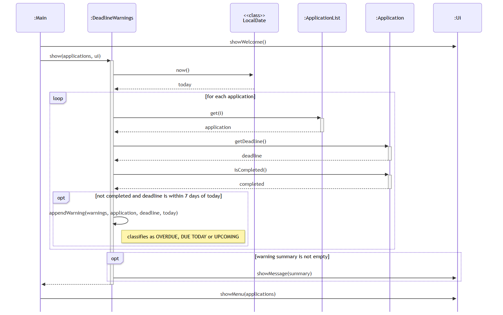
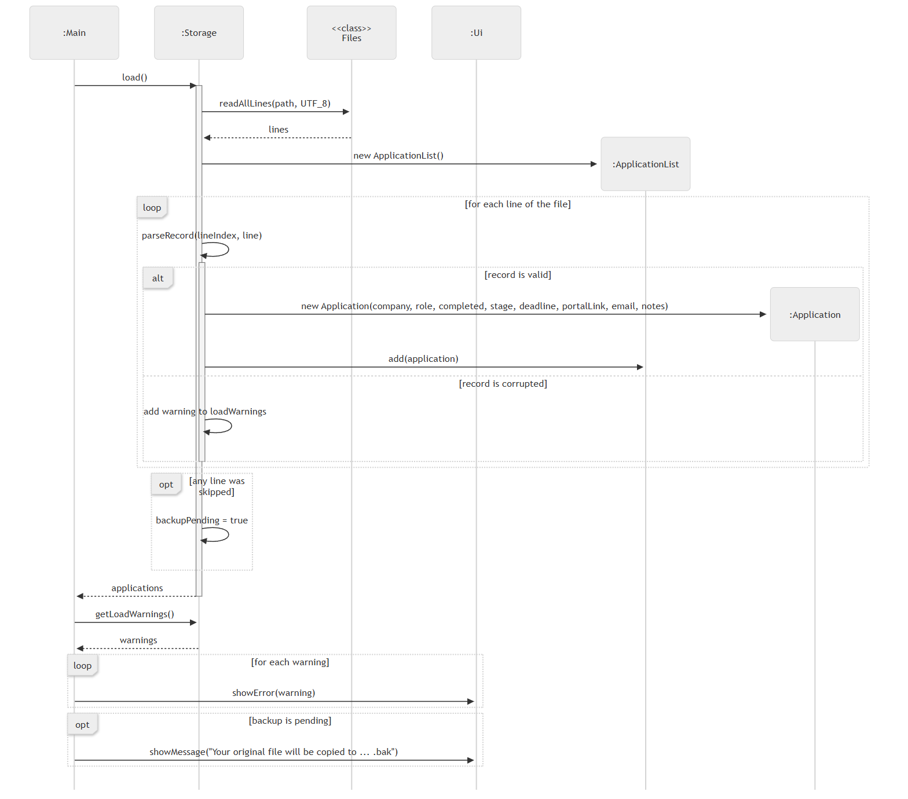

# Chua Jinghao - Project Portfolio Page

## Overview

JobSeek is a command-line application that helps students and job seekers track internship and job applications. Users can record application details, monitor deadlines and manage recruitment progress, with records saved locally between sessions.

My contributions focused on application deletion, deadline warnings, local storage and recruitment stage tracking, supported by automated tests and user and developer documentation.

## Summary of contributions

### Code contributed

[tP Code Dashboard (RepoSense)](https://nus-cs2113-ay2627-s1.github.io/tp-dashboard/?search=jinghaochua)

### Enhancements implemented

**Deleting applications** - [PR #16](https://github.com/AY2627S1-CS2113-T10-2/tp/pull/16)

- **Purpose:** Implemented `DeleteCommand` to remove an application by its application number and save the updated list, allowing users to remove duplicates and unwanted records.
- **Depth and challenge:** Connected deletion to the shared list and persistence. The key concern was removing only a valid target: checked empty lists and index bounds before mutation, and asserted that deletion reduces the list size by exactly one.
- **Completeness:** Covered selection, validation, removal and saving, with tests for successful deletion, invalid indices and empty lists. Invalid requests leave records unchanged; the assertion checks internal consistency separately from user-input validation.

**Startup deadline warnings** - [PR #24](https://github.com/AY2627S1-CS2113-T10-2/tp/pull/24)

- **Purpose:** Added optional deadlines and startup warnings so users can identify urgent applications when opening JobSeek.
- **Depth and challenge:** Connected optional deadlines across input, the model, storage and startup. Handling missing dates and the inclusive seven-day boundary required explicit rules: used `LocalDate`, excluded completed or undated records, and classified the remainder as overdue, due today or upcoming.
- **Completeness:** Supported entering, saving, restoring and checking deadlines, with startup-related tests and storage tests for dated and undated records. Derived warnings at startup instead of storing classifications that become stale. The scope is startup notification, not continuous reminders.

**Local text-file storage** - [PR #24](https://github.com/AY2627S1-CS2113-T10-2/tp/pull/24)

- **Purpose:** Implemented UTF-8 storage for company, role, completion status and optional deadline so users can retain records across sessions.
- **Depth and challenge:** Implemented both encoding and decoding. Tabs, newlines and backslashes inside text must survive saving without becoming record separators; paired escaping with decoding and validated structure, completion values and dates. Centralised this logic in `Storage` for reuse by commands.
- **Completeness and trade-off:** Covered saving and reloading, with tests for persistence, optional dates, headers, escaped content and malformed data. Rewriting the list supports additions, changes and deletions through one operation, at the cost of processing every record. Atomic replacement remains a possible improvement, not an implemented guarantee.

**Recruitment stage tracking** - [PR #48](https://github.com/AY2627S1-CS2113-T10-2/tp/pull/48), [PR #49](https://github.com/AY2627S1-CS2113-T10-2/tp/pull/49), [PR #54](https://github.com/AY2627S1-CS2113-T10-2/tp/pull/54)

- **Purpose:** Added the `RecruitmentStage` enum and integrated it with existing application features to distinguish Applied, Online Assessment, Interview, Offer, Accepted, Rejected and Withdrawn stages.
- **Implementation:** Supported case-insensitive labels, whitespace variations and shortcuts such as `oa`, while rejecting unknown stages. Identified Accepted, Rejected and Withdrawn as terminal outcomes.
- **Depth and challenge:** Preserving older records while changing a shared model required coordinated updates across commands, parsing, display and storage. Mapped `Pending` to `Applied`, supported older records, and renamed status-related code consistently to distinguish recruitment stage from completion.
- **Completeness:** Integrated stage parsing, model values, command handling, display and persistence. Added `RecruitmentStageTest` for labels, shortcuts, terminal outcomes and invalid input; updated command, model, storage and integration tests to check the affected workflows together.

### Contributions to the User Guide

- Documented optional deadline input and startup warning categories, including which applications produce warnings.
- Explained deletion and changes to application numbering; updated the Data section with persistence behavior and limitations.
- Improved terminal launch instructions in Quick start and updated recruitment stage names, instructions and examples.

### Contributions to the Developer Guide

- Documented deadline warning rules, implementation and design considerations, with class and sequence diagrams.
- Explained the storage format, escaping, saving/loading workflows and error handling; added a sequence diagram for loading saved applications.
- Updated recruitment stage terminology and implementation descriptions, and added the acknowledgements section.

### Contributions to team-based tasks and code quality

- **Storage fixes:** Preserved `#`-prefixed company names on reload (`6e04dd4`) and blocked edits/saves after fatal loading errors (`69fc0cd`), protecting existing records from being overwritten by an empty fallback list.
- **Save-failure rollback:** Restored in-memory changes after failed saves and retained failed undo entries for retry (`a96c991`). Preserved object identity so earlier undo history remains valid.
- **Verification:** Added eight regression tests across these fixes, covering legacy records, recovery, modifying commands and undo retries. Full tests and Checkstyle passed with Java 25; updated the UG and DG to explain the behavior.

### Review/mentoring contributions

- Reviewed teammate Beal Ng's [PR #68](https://github.com/AY2627S1-CS2113-T10-2/tp/pull/68) on menu and command-validation documentation. Suggested [consistent usage-error formatting](https://github.com/AY2627S1-CS2113-T10-2/tp/pull/68#discussion_r4440549627) and requested [clarification of leading/trailing whitespace handling](https://github.com/AY2627S1-CS2113-T10-2/tp/pull/68#discussion_r4440562217).

### Contributions beyond the project team

- Reviewed TutorLedger's Developer Guide in [W12-2 PR #5](https://github.com/NUS-CS2113-AY2627-S1/tp/pull/5). Suggested clarifying enforcement of the [52-week input limit](https://github.com/NUS-CS2113-AY2627-S1/tp/pull/5#discussion_r4408256843) and documenting [performance checks for larger datasets](https://github.com/NUS-CS2113-AY2627-S1/tp/pull/5#discussion_r4408260217).

- Through the same cross-team review, suggested clarifying how [empty optional fields in legacy records](https://github.com/NUS-CS2113-AY2627-S1/tp/pull/5#discussion_r4414763726) are handled and reminding developers to [update the field count when extending stored records](https://github.com/NUS-CS2113-AY2627-S1/tp/pull/5#discussion_r4414823966). This feedback focused on making persistence documentation easier for future contributors to maintain.

## Contributions to the User Guide

Selected and adapted from my [User Guide contribution](https://github.com/AY2627S1-CS2113-T10-2/tp/commit/233a3d6). Instructions below reflect the current application, including later team changes to deletion confirmation, undo and storage recovery. Those later changes are included for accuracy, not claimed as my implementation.

### Starting JobSeek and recording deadlines

Install Java 25, download `jobseek.jar`, and place it in a folder where you have write permission. Open a terminal in that folder and run `java -jar jobseek.jar`. Double-clicking the JAR may not open a usable terminal window. Use the same launch folder each time to access the same saved records.

When adding an application, enter a company and role. At the deadline prompt, enter a valid date in `YYYY-MM-DD` format, such as `2026-11-03`, or press Enter if no deadline is known. An invalid date produces an error and another prompt. Leaving the deadline blank still allows the application to be tracked.

### Understanding deadline warnings

JobSeek checks deadlines at startup and displays warnings before the main menu. Only incomplete applications with a recorded deadline are included.

- **OVERDUE:** The deadline is earlier than today.
- **DUE TODAY:** The deadline is today.
- **UPCOMING:** The deadline is within the next seven days, including exactly seven days away.

For example, if today is `2026-10-28`, these warnings may appear:

```text
Deadline warnings:
OVERDUE: Google - SWE Intern (deadline 2026-10-27)
DUE TODAY: Shopee - Backend Intern (deadline 2026-10-28)
UPCOMING: GovTech - Data Analyst (deadline 2026-11-03)
```

If no applications require attention, no warning summary appears. Startup warnings do not refresh automatically while JobSeek remains open; use `today` for an on-demand deadline view.

### Deleting a record and retaining saved data

Enter `list all` to identify the application number, choose menu option `4`, and enter that number. Confirm with `y` or `yes`; another response cancels deletion. You can reverse the latest change using `undo`. Numbers after a deleted entry shift down by one, so check the list before deleting another record. Empty lists and invalid numbers produce an error without deleting anything.

Changes are saved to `data/applications.txt` and loaded at the next startup. If the file does not exist, JobSeek starts with an empty list. If malformed records are skipped, read the warnings and back up or repair the file before making further changes: the next save writes only the records that loaded successfully.

Company names starting with `#` are retained on reload. A fatal loading error blocks edits and saves: repair or restore the file, then restart. A failed save restores the previous in-memory state; a failed undo retains its history entry for retry. Success is reported only after saving succeeds.

## Contributions to the Developer Guide

### Deadline warnings: responsibilities and interactions

Adapted from my [deadline warnings and storage documentation](https://github.com/AY2627S1-CS2113-T10-2/tp/commit/647824d). The diagrams reproduced here are the current team-maintained renderings of workflows I originally documented; subsequent formatting and recovery changes are not claimed as solely mine.

`Main` coordinates startup, `DeadlineWarnings` selects and classifies applications, `ApplicationList` provides the records, and `Ui` displays the accumulated summary. Each `Application` stores its deadline as a `LocalDate`; `null` represents an unknown deadline. Calendar dates are sufficient because the feature does not track a time of day.



The check excludes completed applications, missing deadlines and dates later than today plus seven days. It labels earlier dates `OVERDUE`, today's date `DUE TODAY`, and the remaining dates `UPCOMING`. The boundary is inclusive: on `2026-10-28`, `2026-11-04` qualifies but `2026-11-05` does not. Overdue records have no lower date boundary.

**Design rationale:** Keeping classification outside `Main` gives the startup coordinator fewer responsibilities. Warnings are derived from the date and application data instead of being stored, avoiding stale classifications. A `StringBuilder` accumulates entries for one display operation; no message is produced when the summary is empty.

### Local storage: format, saving and design choices

Adapted from the storage section I introduced in [commit 647824d](https://github.com/AY2627S1-CS2113-T10-2/tp/commit/647824d) and my later recruitment-stage integration. The original format stored four fields. The description below includes the team's subsequent eight-field format so that it matches the current application.

**Responsibilities and location.** `Storage` handles file access and conversion between application objects and text. `ApplicationList` holds the records in memory, while commands request saves after modifying records. The default path is `data/applications.txt`; accepting a custom path also lets tests use temporary files without touching user data.

**Record structure.** The file uses UTF-8 encoding, two header lines and tab-separated application records. Current records contain these fields in order:

1. Company: escaped text.
2. Role: escaped text.
3. Completion flag: `true` or `false`.
4. Deadline: an ISO date, or an empty field.
5. Recruitment stage: a stage label such as `Applied`.
6. Company portal link: escaped text, or an empty field.
7. Contact email: escaped text, or an empty field.
8. Notes: escaped text, or an empty field.

Backslashes, tabs, newlines and carriage returns inside text fields are escaped before saving and decoded during loading. This distinguishes content from the delimiters separating fields and records. An empty deadline represents an application with no recorded closing date.

**Compatibility.** The loader accepts older four-field and five-field records as well as the current eight-field format. Records without a stage default to `Applied`, and the former `Pending` label maps to `Applied`. Missing portal links, emails and notes become empty strings. The next save uses the current format.

**Saving workflow.** A modifying command calls `Storage.save(applications)`. Storage resolves the path, creates missing parent directories, adds the title and column headers, converts each application into a record and writes the full list using UTF-8. Deleting a record from the list therefore removes it from the next saved file as well.

**Trade-offs documented:** A human-readable text format is straightforward to inspect and uses Java's standard file APIs. JSON would offer a different way to represent named fields but require a different serialisation approach. Rewriting the complete list gives additions, edits and deletions one consistent save operation, at the cost of processing every record on each save. Keeping encoding within `Storage` concentrates format changes in one component.

### Local storage: loading, validation and recovery

I documented the loading sequence and error handling in [commit 647824d](https://github.com/AY2627S1-CS2113-T10-2/tp/commit/647824d). The team's current diagram below extends that workflow with recovery from malformed records; this recovery behavior differs from the original fail-on-error implementation.



`Main` requests saved records before entering the interaction loop. A missing file produces an empty list. Otherwise, storage ignores blank lines, comments and recognised headers, then decodes and validates each record. Checks cover field counts, completion flags, non-empty company and role values, optional dates and recruitment stages. Valid records become `Application` objects in the returned list.

**Loading protection:** Invalid records are skipped with line-specific warnings; the next save includes only loaded records. Fatal file-reading errors, including invalid UTF-8, block saves through `Storage.ensureWritable()`. `Main` checks this before editing the empty fallback list. A successful reload releases the block. Records beginning with `#` are parsed when they contain tab separators, preserving valid company names.

**Save-failure rollback:** `saveOrRollback()` reverses failed changes and clears their history flag. Undo peeks at history, snapshots the list and saves the reversal before popping the command. A failed undo restores the snapshot and keeps the entry for retry. The snapshot preserves original object identities, field values and ordering, so older commands still refer to the correct applications. These fixes are recorded in `6e04dd4`, `69fc0cd` and `a96c991`.

**Design considerations and extensions:** Keeping file handling separate from commands makes the loading rules easier to maintain. A temporary file followed by atomic replacement could reduce damage from interrupted saves. Keeping a backup before the first save after recovery could protect skipped records. These are possible improvements, not claims of implemented features.
